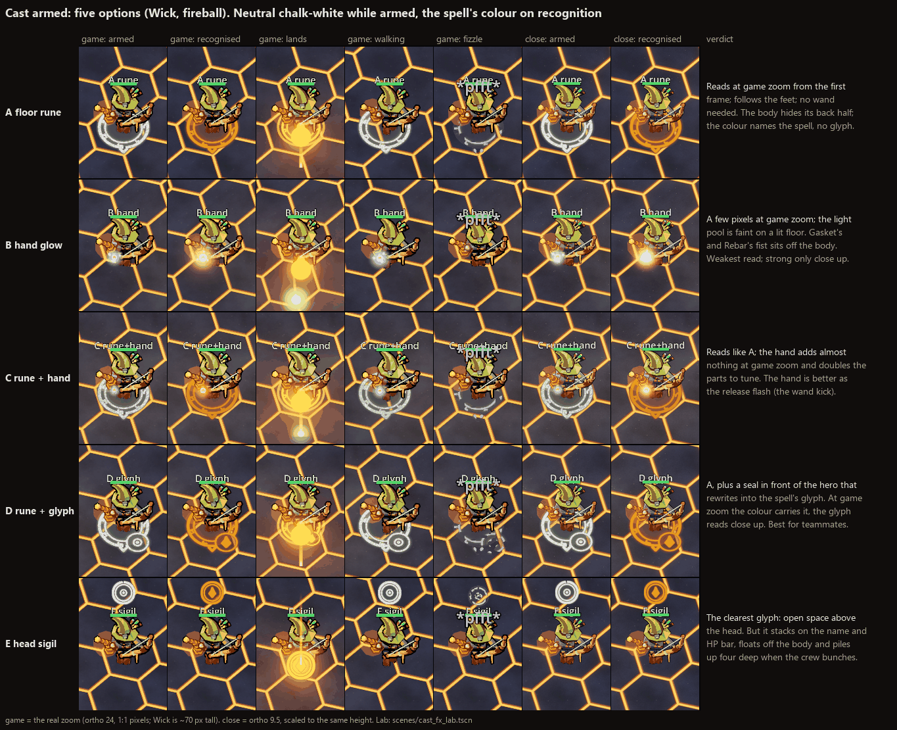

# Cast armed: options for the tell between "cast" and the spell

**The user's direction (2026-10-22):** "I love the idea of an effect once you call 'cast' before you finish the spell.
Maybe the player's hand glows or there's a rune on the floor that follows the player until they cast. The latter might
make more sense because none of the players actually have a wand. Let's look at options."

The five options below were a **[proposal]** mocked in a lab; option C is now in the game (next section). The lab:

- The lab is `scenes/cast_fx_lab.tscn` (`scripts/fx/cast_fx_lab.gd`).
- The mock effect is `scripts/fx/cast_armed_fx.gd` (`CastArmedFx`, styles `rune`, `hand`, `rune_hand`, `glyph` and
  `sigil`).
- The lab casts a real fireball through `Hero.try_cast`, so the hand-off into the spell is the real one.
- It does not change `hero.gd`. The hand options raise Wick's wand through the model's own arm-kick dictionary, in the lab
  only, the way the animation lab does.

This page answers gap 4 of `animation-research.md` ("the 0.3-1 s of speaking before a spell is invisible"). It is the
voice channel of its treatment C, cut down to the moment the user asked for: the trigger word.



## Option C in the game (playtest 2026-10-22, decided 2026-10-23)

**The user (2026-10-22):** "Let's play test C, but I'm not sure about if the circle should change color or not."

**Decided (user, 2026-10-23): "For colors - color is fine actually. It works better then I expected. Lets remove the
keybinding."** The tell in **colour** mode is the game's default in normal play, exported builds and crews (no flag needed;
`CastTell.mode` starts as colour). The gym's F11 is gone. `--cast-tell neutral|off` stays as a flag (neutral was trivial to
keep). Experiments now go in the gym's panel, not on keys (the user, same day).

So option C (the floor rune and the hand glow) is wired into the game for **your own hero**, with a live A/B on the colour
question (now settled: colour). Nothing goes over the network yet: other players see only the release, as before.

- **The code:** `scripts/fx/cast_tell.gd` (`CastTell`). `game.gd` attaches one per floor, after `MoveFeelTag`.
- **What drives it:** the real voice pipeline.
  - `VoiceCaster.trigger_heard` arms it.
  - `spell_spoken` recognises the spell.
  - `Hero.spell_cast` releases it. Online the release waits `NetCasts.LEAD`, until the cast lands.
  - A spell word with no cast is a refusal (cooldown, out of components, not slotted), and so is a repeat the recognizer
    `ignored`: the rune cracks.
  - `spell_fizzled` cracks it.
  - The new `VoiceCaster.trigger_dropped` (from `Incantation.trigger_dropped`) fades it quietly. It fires for a "cast"
    buried in chatter or whose window runs out with no fizzle.
  - A safety timeout of 2.8 s fades a tell that no event ends.
- **The modes** (colour is the default):
  - **colour:** the rune floods with the spell's colour on recognition, its chalk turns solid, and the release is in colour.
  - **neutral:** the rune stays chalk white until it is gone. Only the release flash is coloured: the hand flash and the
    shock ring.
  - **off:** no tell; nothing is built or drawn.
- **Switching modes:** `--cast-tell colour|neutral|off` sets the mode. Boot reads it once per run, and it is a menu flag,
  so the menu still opens. The default is **colour**. (Until 2026-10-23, F11 in the gym cycled the three.)
- **Solo timing:** the spell word and the cast arrive in the same frame, so the colour mode's flood shows mostly in the
  0.3 s release. Online the flood gets the 0.2 s before the cast lands.
- **Cost:** two persistent quads (the rune decal and the hand glow). They are built on the first trigger and hidden when
  idle, and the shader parameters are set by StringName, so nothing is allocated per frame. The shock ring at the release
  is the existing `Fx.ring`.
- **Draw order:** the rune draws at render priority -2, under the gym's hit-area overlay (10).
- **Colours:** the spell colours are converted to linear before they reach the shader.
- **The hand glow:** it sits on the held component, which is in the free hand for all three heroes. Without a component it
  sits on Wick's wand tip, else at chest height.
- **What it doesn't touch:** hero posing, and audio ducking.
- **Test:** `tests/test_cast_tell.gd` checks colour as the default, colour and neutral, off, the real typed pipeline and
  Incantation's drop; `test_gym` that the tell is on the player in colour.

## 1. What has to be true

- **It reads at the game camera.** That is yaw 45, pitch -56, ortho 24 at 1920x1080, so 45 px per world unit. Heroes are
  55-75 px tall there. Floor shapes read best: the hero covers its own hand, and the pitch flattens anything upright.
- **It starts on the trigger word.** That is `VoiceCaster.trigger_heard`, the moment the `cast_heard` cue already plays.
  It ends when the spell lands, when the window runs out, or when the cast is refused. Section 2 has the exact events.
- **It survives movement-heavy play.** It must follow a walking, strafing, turning hero without smearing or lagging
  behind.
- **No wand is needed.** Gasket fights with a wrench and Rebar with his fists. Wick has a stubby copper wand in his belt.
  The held component is in the off hand. Another agent is fixing where it sits, so this page doesn't depend on it.
- **Colours: neutral, then the spell's colour.**
  - While armed, the tell is a cool chalk white, `(0.86, 0.93, 1.0)`. No spell owns that colour. It isn't the amber of
    the floor seams, the bow's charge ring (hero colour, radius 1.05) or the van's amber summoning circle.
  - On recognition, the tell floods with the spell's `SpellBook.color_of`.
  - The neutral state also looks different: dashed, dimmer "chalk" lines. The recognised state is solid. So Teeth's cream
    still reads as "recognised" (section 7).
- **Low-poly toon look.** Flat lines with a dark toon outline (the heroes have one), a slight bloom, and no particles
  while armed. The spell colours go to the shader in linear space. Passing them raw makes them pastel.

## 2. The timeline

These timings are estimates from the recognizer's notes (`incantation.gd` header, `stt-latency-staggered-streams.md`). I
didn't measure them for this page.

| Moment | Source today | When (typ.) | What the tell does |
|---|---|---|---|
| Speech onset | `VoiceCaster.speech_started` | 0 | Nothing (open question 1: a "listening" tell) |
| **Trigger heard** | `trigger_heard` (`Incantation.trigger_armed`, once per trigger) | First partial with CAST, about 0.3 s into "cast"; or about 0.15 s after "cast" when a pause ends it as its own utterance | **Arms.** It draws itself in clockwise from the aim notch in 0.22 s, with a bright pen point at the front, then turns slowly and pulses 8%. The `cast_heard` cue plays with it. |
| Armed, waiting | | The time it takes to say the spell word, about 0.3-0.8 s fluent, longer after a pause | Follows the feet (section 3). After 0.6 s armed, the outer ring recedes back to the notch: a countdown to the window's end. |
| **Spell word recognised** | `spell_spoken` (about 0.15 s after the voice stops; exact matches fire on the first partial) | | **Floods** with the spell's colour in 0.10 s. The chalk turns solid, and in D the hub rewrites into the glyph. |
| **The cast lands** | Solo: the same frame (`Hero.try_cast` → `spell_cast`). Online: `NetCasts.LEAD` (0.2 s) later on every machine, the caster's included | | **Releases.** It snaps in to half size with a flash (0.07 s). A streak runs from the tell to the resolved target (head in 0.12 s, tail after it). A small shock ring plays in the spell colour. Everything is gone by 0.32 s, and the real spell has taken over. |
| Refused | `game._cast`: cooldown, out of components, not slotted | | Proposal: it takes the spell's colour, then cracks like a fizzle. That means "heard you, can't". |
| **Window runs out: fizzle** | `spell_fizzled` (`no_spell` / `garbled` / `unknown_spell`, after `TUNING.window` = 1.8 s of recognition time) | | **Cracks.** The lines break into pieces from a hash noise, go grey and sag outward over 0.45 s. `SpellBook.fizzle`'s grey puff and "*pfft*" play as they already do. |
| Window runs out: quiet | A trigger buried mid-sentence in loose mode expires **with no event** (`Incantation._expire` drops it) | | **Fades** in 0.25 s. This needs a new signal, say `VoiceCaster.trigger_dropped`, or the tell would hang. |
| "cast" again while armed | `trigger_heard` again | | Restarts the draw-in. |

- **Online timing.** The 0.2 s gap between recognition and landing is exactly what the colour flood fills. Solo, the two
  are one frame, so the colour shows only in the release flash.
- **The lab's script.** The stand clip has trigger 0.40, spell word 1.10 and landing 1.30, which is the online case. The
  walk clip has trigger 0.35, spell word 1.25 and landing 1.45. The cancel clip has trigger 0.30 and a fizzle at 2.10.
- **The window is in recognition time.** The game should end the tell on the recognizer's events, not on a timer of its
  own. The countdown ring is a hint, not a promise.

## 3. The options

These figures apply to all five options:

- Wick's rune is 0.82 u in radius: 74 x 61 px at game zoom, about one hero wide.
- Its lines are 0.065 u wide (3 px), each with a dark outline.
- Gasket's rune is 0.92 u and Rebar's 1.05 u, because those heroes are wider.
- The rune trails the feet at a rate of 22/s, about 0.2 u behind at a walk.

Strips: `cast_armed/strip_stand_game.png` (game zoom, 1:1), `strip_stand_close.png`, `strip_walk_game.png`,
`strip_cancel_close.png`, `glyphs.png` and `heroes.png`.

### A. Floor rune
A chalk circle under the hero:
- an outer ring;
- an inner ring;
- a band of seven small hashed runes that turns slowly;
- a chevron notch outside the ring that always points at the aim;
- a faint dark scorch inside, so the lines read against the amber seams.

- **Game camera:** reads from the first frame of the draw-in. It is the biggest, steadiest shape of the five, and it
  shows even while the fireball goes off. The body hides its back half, so the front arc and the notch do the work.
- **Walking:** trails the feet slightly, enough to feel dragged along without detaching. It holds through the dog-leg
  turn (`strip_walk_game.png`, 0.90). Because it is flat on the floor, it never covers the hero.
- **Release:** snaps inward with a flash and a floor streak to the target. It reads as "that came from me".
- **Cancel:** cracking into grey pieces is very readable, and nobody confuses it with a cast.
- **Others:** the same rune, driven by the armed event (section 5).
- **Pros:** it reads best for the least art. It needs no wand. It works for every hero and size, and it doubles as an aim
  telegraph.
- **Cons:** its colour names the spell, but nothing else does. Heal and Vines are both green, and Fireball sits close to
  the amber seams. It also adds a floor decal in fights that already have rings: the bow charge, corn's telegraph and the
  armor zone.

### B. Hand glow
A cool orb at the casting hand: Wick's wand tip, with the wand drawn half up in the lab; Gasket's and Rebar's off-hand
fist, where the component sits. It has three orbiting motes and a small light that pools on the floor.

- **Game camera:** the weakest. The core is about 5 px. On a lit floor the light pool barely shows, and in most poses
  the hand is in front of or behind the body.
- **Walking:** rides the arm swing. That reads close up and is lost at game zoom.
- **Release:** the orb darts to the target. It is a good release on its own.
- **Cancel:** sputters out grey.
- **Pros:** physical; "my hand is charged".
- **Cons:**
  - There is no wand for two of the three heroes.
  - Gasket's and Rebar's fist sits off the body today (`heroes.png`).
  - It fights the held component for the same spot (gap 8).
  - It needs per-model posing, which is the other agent's area.

### C. Rune + hand glow
A's rune (dimmer) plus B's orb without the light.

- **Game camera:** reads like A. The orb adds almost nothing at that zoom.
- **Pros:** reads well close up.
- **Cons:** two things to tune. The hand part costs the posing work for little gain. The hand is better spent on the
  release: the existing wand kick, plus a flash at the hand.

### D. Rune + spell glyph
A's rune, plus a **seal** that cuts the ring at its lower right, in front of the hero whatever the aim:
- The seal is a dark disc 0.36 u in radius, so 16 px.
- While armed, it holds a small neutral hub: a ring and a dot.
- On recognition, the hub rewrites stroke by stroke into the spell's glyph, in the spell's colour: a flame (fireball), a
  cross (heal), a cob (corn), a shield (armor), a curl (tentacles), fangs (teeth), a leaf (vines), a drop (damp), a cup
  (coffee) or a claw (chicken).
- On release, the glyph lifts off the floor and swells as the rune snaps.

- **Game camera:** the colour carries the read. The glyph is about 19 px across. The cross, shield, drop and claw stay
  legible at 1:1 (`glyphs.png`, bottom); the flame and the cob don't.
- **The centre is useless:** the hero stands on it, and a glyph there is never seen. That is why the seal sits on the
  ring's front.
- **Walking:** as A.
- **Others:** a teammate sees which spell is coming as soon as the cast event arrives, about 0.2 s before it lands
  online. That matters most for heal, armor and corn.
- **Pros:** all of A's, plus it names the spell. That helps with same-hued spells (heal and vines) and with the amber
  floor.
- **Cons:**
  - Ten glyphs to keep. A new spell needs one.
  - The seal hides the notch when the aim points to the lower right. (The notch is shown only while armed; the release
    streak shows the direction anyway.)

### E. Head sigil
A small camera-facing rune disc above the name: 0.36 u radius, 32 px across, with the same draw-in, countdown, flood and
glyph (at the centre). On release it darts to the target.

- **Game camera:** the clearest glyph of the five, because the space above a head is empty and the disc faces the camera.
- **Walking:** fine; it rides the hero rigidly.
- **Cons:**
  - It stacks on the HP bar and the name. The lab already lifts it 0.62 u up the screen from the name, so it doesn't sit
    on the text.
  - It floats off the body, so it reads as UI, not magic.
  - With four heroes bunched up, four discs pile up over the crowd.
  - It is the only option that adds height above a hero.
  - The local player has no name label, so it would sit lower on your own hero than on the others.

### Summary

| | Reads at game zoom | Names the spell | Walking | Release | Clutter | Effort |
|---|---|---|---|---|---|---|
| A rune | **yes** | colour | trails the feet, good | snap + streak | a floor decal | S |
| B hand | barely | colour | lost in the arm swing | orb darts, good | low | M (posing per model) |
| C rune+hand | yes (the rune) | colour | good | both | medium | M |
| **D rune+glyph** | **yes** | **colour + glyph** | good | snap + glyph lifts | a floor decal + seal | S-M (glyph table) |
| E sigil | yes, the clearest glyph | colour + glyph | good | darts | above the head, stacks with the bars | S |

## 4. Recommendation

**D, the rune with the glyph seal. B's hand is used only at the release.**

- **Arming:** A's behaviour: the draw-in from the aim notch, the slow turn, trailing the feet, the countdown ring, and the
  chalk-to-solid change on recognition.
- **The seal:** names the spell for teammates and keeps same-coloured spells apart. It is cheap: one more `vec4[12]`
  uniform and a table of strokes.
- **The hand:** only at the release. Keep the existing cast pose (Wick's wand kick; Gasket's and Rebar's arm kicks) and
  add a one-frame flash at the hand when the spell lands. Once the other agent has fixed the held component, that is
  where the flash goes. Gap 8 suggests the same thing ("make the component the focus").
- **E:** keep it in reserve. If playtests show floor decals getting lost in big fights (corn telegraphs, lava, goo
  patches), the sigil is the fallback for **other players' tells only**.
- **Cost:** one shader quad per armed hero (no per-frame allocation) and a short-lived streak quad. There is nothing on
  the wire per frame. The lab's `CastArmedFx` is written to be lifted almost as is: a LOCAL node per hero, driven by
  signals.

## 5. Networking

- **On your own screen it is free.** `trigger_heard`, `spell_spoken`, `spell_fizzled` and `Hero.spell_cast` are all local.
  The one missing piece is a signal for a quietly expired trigger (section 2).
- **Other players' screens need a tiny event.** Shape: **cosmetic, driven by one owner event**, like `act` (the hero
  attack replay in `NetCasts`). It changes no gameplay state, and its looks are local. I haven't built it. The sketch:
  - `arm {c: hero id, k: 1 armed | 0 fizzled | 2 dropped, t: shared time}`. It is reliable and goes from the owner to
    the host, which relays it to the other clients. That is the same path and the same seat check as `act` and `cast`
    in `NetCasts._on_event`.
  - It is sent from `scripts/net/` only. The game calls something like `Net.note_armed(hero, kind)` next to
    `Net.note_voice`.
  - A puppet starts its tell when its shown time reaches `t`, as `act` replays do (`render_time`), so the rune doesn't
    appear before the puppet's mouth moves.
  - **Recognition costs nothing extra.** The `cast` event already carries the spell id and lands at `at` = send time +
    `LEAD`. A puppet floods its tell with the spell's colour and glyph when the cast event **arrives**, and releases at
    `at`. On a link slower than LEAD one way, both happen together, which is what happens today.
  - **Fizzles become visible to the crew.** Today `SpellBook.fizzle` is local to the speaker.
  - **Cost:** about 20-40 bytes per trigger and per fizzle or drop, so tens of messages per player-minute. Nothing per
    frame. There is no new `OWNER` var: the tell node is `LOCAL` on `Hero`. A new hero var would be declared `LOCAL` in
    `Hero.net_fields()`.
  - **Late join:** skipped, since a tell lasts under 2 s. That goes in the hero's `NetEvents.LATE_JOIN` text, like the
    wind-ups.
  - **Safety:** a puppet whose tell never gets an end (its owner dropped) times out on its own after the window + 0.5 s.
- **New-content checklist** (`networking.md`):
  1. Shape: cosmetic, plus an owner event. The owner is the speaking player.
  2. New vars: none replicated; the tell node is LOCAL.
  3. Verbs and `Combat`: none.
  4. Randomness: none. The crack pattern is a hash in the shader.
  5. Motion: a function of the hero's shown position and the event times.
  6. Cosmetic vs gameplay: entirely cosmetic.
  7. Late joiner: sees nothing until the next trigger.
- **Passive data:** the event's `t` lets the casts sheet record armed-to-cast time per cast, next to the onset and
  latency `Net.note_voice` already sends. No new screens or keys.

## 6. What the mocks show

- **`sheet.png`.** At the game zoom, A, C and D read from the first armed frame. B is a few pixels at the hip. E is very
  clear but sits in the HUD's space.
- **`strip_stand_game.png`.** The chalk-to-solid change at 1.22 reads at 1:1. The release (1.32-1.38) snaps the ring
  into the fireball's launch. The shock ring is the last thing on the floor at 1.55.
- **`strip_walk_game.png`.** The rune trails a little through the dog-leg turn (0.90-1.10) and catches up on the stop.
  The hand glow is lost in the arm swing.
- **`strip_cancel_close.png`.** After 0.6 s the outer ring recedes toward the notch, which is subtle on the rune and
  clearer on the sigil. The crack at 2.15-2.30 can't be mistaken for a cast, and the "*pfft*" puff lands with it.
- **`glyphs.png`.**
  - Ten spell colours on the rune. Fireball's orange is closest to the amber seams. Coffee's brown is the dimmest. Heal
    and Vines are both green.
  - Teeth's cream is near the neutral colour, and only the chalk-to-solid change separates them.
  - At 1:1 the cross, shield, drop and claw stay legible, and the flame, cob and curl become blobs.
- **`heroes.png`.** Gasket's wide coat and Rebar's bulk hide more of the ring, so their runes are bigger (0.92 and
  1.05). B's glow sits on the held component's fist, out to the side.

## 7. Open questions for the user

1. **A "listening" tell at speech onset?** For example a faint dotted ring before "cast" is recognised. It hides more
   latency, but every sentence to your friends would flicker it. The mock starts on the trigger word only, as asked.
2. **The countdown ring.** Is it useful, or noise? It is subtle on the rune. It could also be cut entirely.
3. **Should other players see your tell?** If so, that is the `arm` event in section 5. Without it, puppets show only
   the release, as today.
4. **The glyph's place.** The options are the seal at the ring's lower right (the mock), riding the aim notch (it hides
   behind the hero when you aim up-screen), or no glyph (A).
5. **Colour clashes.**
   - Fireball versus the amber seams.
   - Heal versus Vines.
   - Teeth's cream versus the neutral chalk.
   - Should some spell colours move, or is the glyph enough?
6. **Accidental triggers.** In loose mode, "should I cast heal" arms the tell mid-sentence. Should a mid-sentence trigger
   arm more faintly, or not at all?
7. **Refused casts** (cooldown, out of components): colour and then crack, as proposed, or a different "can't" look?
8. **AI allies.** They never speak, so they would cast with no tell. Should a short fake tell (0.3 s) play before an AI
   cast, so the crew reads all casts the same way?
9. **Self-cast spells** (heal on yourself, armor, coffee). The streak has no length there. Should the release pulse up
   the body instead?

## 8. Files and how to regenerate

| File | What |
|---|---|
| `scenes/cast_fx_lab.tscn`, `scripts/fx/cast_fx_lab.gd` | The lab: five lanes (A-E) of the real hero playing one script of voice events. Run with `--fixed-fps 60`. |
| `scripts/fx/cast_armed_fx.gd` | `CastArmedFx`: the five styles, the rune / glow / streak shaders and the glyph table. LOOK-DEV ONLY. |
| `docs/design/cast_armed/sheet.png` | The comparison sheet: game zoom (armed, recognised, lands, walking, fizzle) and close-up, with a verdict per option. |
| `docs/design/cast_armed/strip_stand_game.png`, `strip_stand_close.png`, `strip_walk_game.png`, `strip_cancel_close.png` | The strips: rows A-E, 8 times each. |
| `docs/design/cast_armed/glyphs.png`, `heroes.png` | D's rune for all ten spells, and Gasket and Rebar. |
| GIFs (not committed) | One per option: stand, then walk, then a fizzle, at game zoom x2 beside the close-up. They are in the session scratchpad as `gifs/cast_armed_{a_rune,b_hand,c_rune_hand,d_glyph,e_sigil}.gif`. |

```
godot --path . --fixed-fps 60 --resolution 1920x1080 -- --scene res://scenes/cast_fx_lab.tscn --clip stand|walk|cancel|expire|lineup --zoom game|close --out <abs dir> [--hero wick|gasket|rebar] [--frames]
```

The lab writes one PNG per lane per strip time, plus GIF frames with `--frames`. The strips and sheets were assembled
and labelled afterwards with a small PIL script, and the GIFs made with ffmpeg's palettegen. Neither script is committed,
as with the animation lab.
