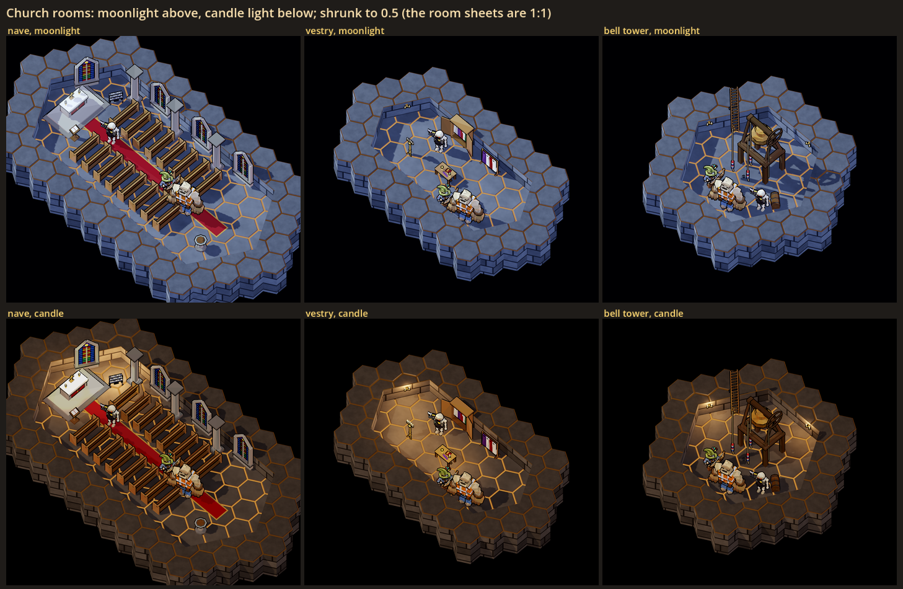
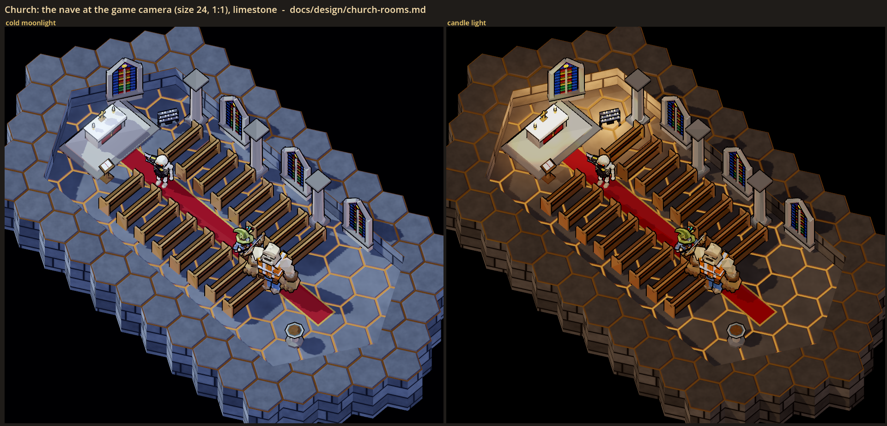
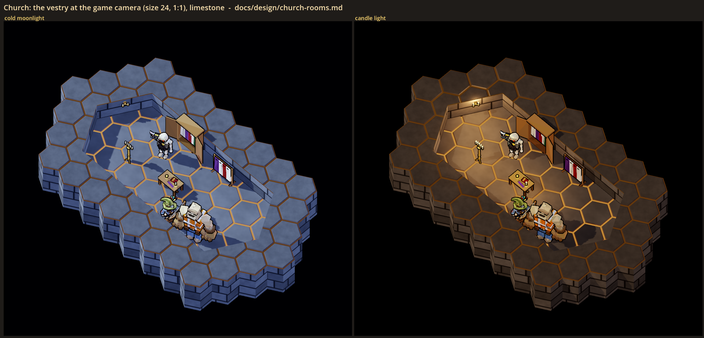
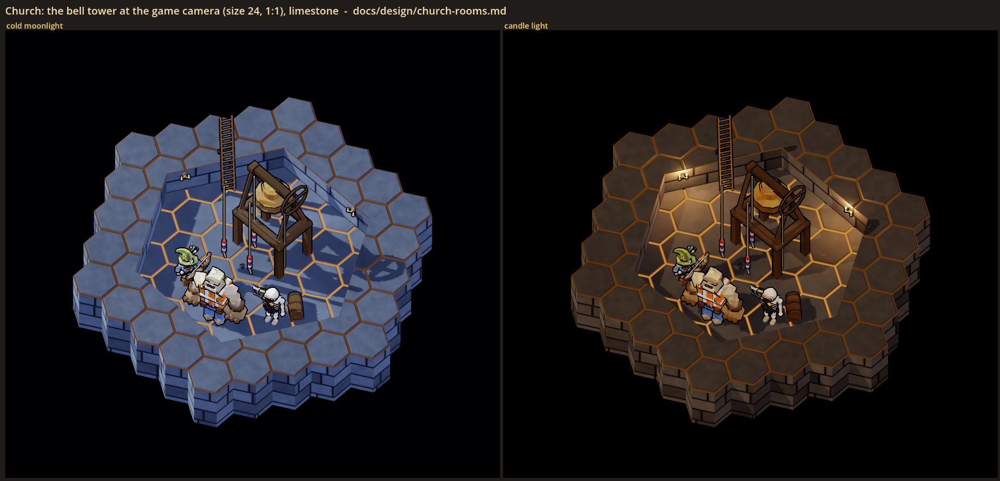
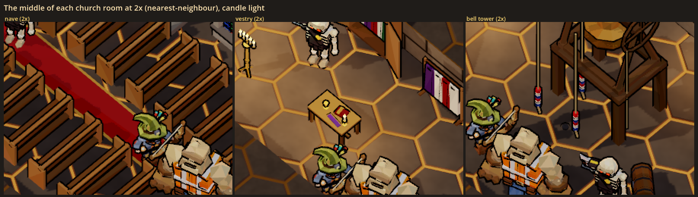
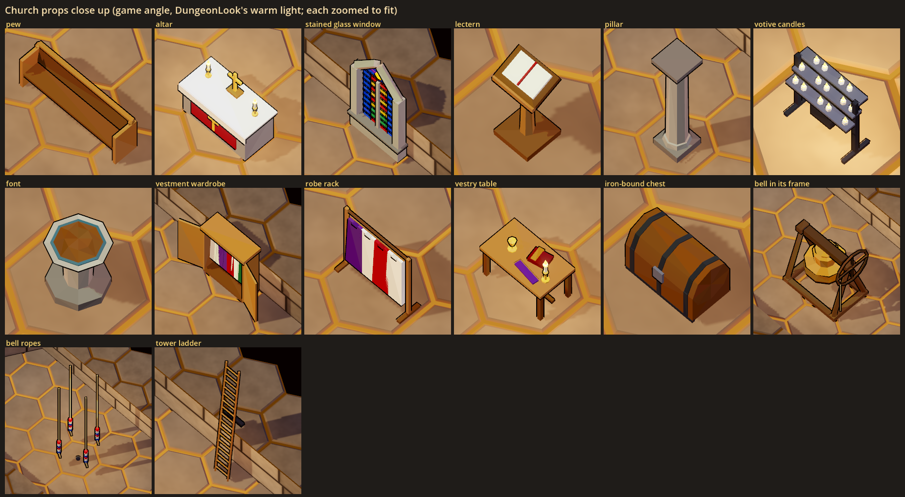

# Church rooms: a visual test

Status: **[look-dev only]**, 2026-10-29. Nothing here is in the game. No room theme, site, floor, planner, contract or
network message uses it. The test lives in a look lab and in the gym.

The decision this serves (new-themes.md, "Ghost house: haunted contracts", Sites): a church or historic estate site would
be a room pool of **nave, vestry, bell tower** plus a crypt section. That only matters if hauntings end up tied to sites
(open question 2 there), so this test is deliberately lighter than the mansion's (`mansion-rooms.md`): one material set,
three rooms, the same two lights and the same machinery.

## What the user is choosing

- **Whether the three rooms read as a church** from the game camera, and which are worth building if sites happen.
- **The material set**: worn limestone flags on the floor and pale limestone block walls (one set only).
- **The light**: cold moonlight or candle light (`HauntLook`, the same switch as the mansion's).

## The sheets

All at the game camera (yaw 45, pitch -56, ortho size 24), 1:1 unless the caption says otherwise, with Wick, Rebar and a
grunt in each room for scale. The rooms use the game's own drawing (midpoint walls, `HexMapView`, `DungeonLook`).



`sheet.png`: the three rooms in moonlight (top) and candle light (bottom), shrunk to 0.5.



`nave.png`: two blocks of pews either side of a red aisle runner, the altar (white cloth, a red and gold frontal, two
candlesticks, a plain gilt cross) on a stone step at the far end, a lectern with a blank book, a rack of votive candles, a
font by the door, three stone pillars, and four lancet windows of coloured glass (one behind the altar end, three along the
side wall).



`vestry.png`: a vestment wardrobe with its doors open on hanging robes, a robe rack, a table with a chalice, a closed book,
a folded stole and a candlestick, an iron-bound chest, a candelabrum and a sconce.



`bell_tower.png`: the ringing chamber: the bell hangs in its timber frame on a deck of beams above head height, with its
wheel; three bell ropes with striped woollen grips drop through the room; a long ladder climbs the wall to a hatch out of
sight; a chest; sconces.



`sheet_2x.png`: the middle of each room doubled with nearest-neighbour scaling (candle light).



`props.png`: the props close up (each zoomed to fit, in the game's warm light).

## How the rooms read at the game camera (first impressions, for the user to overrule)

- **The nave reads at once**, even at 0.5: rows of pews, a red aisle, a white altar, stained glass. It is the strongest of
  the three and the one worth keeping if churches happen.
- **The bell tower reads** once the bell is raised over the ringers: the bell, its wheel and the hanging ropes say "bell
  tower". With the frame standing on the floor it looked like a gallows.
- **The vestry is the weakest.** A wardrobe of robes, a table and a chest read as "a storeroom with robes" more than a
  vestry. It is a small side room; in a site it could share a pool slot with a crypt antechamber.
- **The windows stand above the wall.** The game's walls are 1.5 units, so a lancet window (3.4 tall) rises well above the
  wall line, like a free-standing panel. It reads as a church window from the camera, but it is a cheat.
- **Moonlight on pale stone is strong:** limestone takes the blue key light well and the long pew shadows are good. Candle
  light makes the church warm and calm.

## What was built

The same machinery as the mansion test (`mansion-rooms.md`, What was built), all cosmetic:

| Piece | Where | What |
|---|---|---|
| `ChurchProps` | `scripts/art/lowpoly/haunt/church_props.gd` | 15 church props (pew, altar, altar step, stained window, lectern, pillar, votive candles, font, vestment wardrobe, robe rack, vestry table, chest, bell frame (raisable onto a belfry deck), bell ropes, tower ladder). Built through `HauntProps.build`. |
| The materials | `HauntLook.CHURCH` | Limestone flags (the game's flagstone pattern, paler) and limestone blocks (the game's ashlar pattern, paler), in the lab-only table slots 26 and 29. |
| The lab | `scripts/art/lowpoly/haunt/church_rooms_lab.gd`, `scenes/church_rooms_lab.tscn` | The three room layouts and the sheets above (extends `HauntRoomLab`). |
| The gym | `GymSpawns` group `rooms` | Spawn buttons for the pew, the altar, the stained window and the bell frame, beside the mansion's; the **Haunt light** row relights them. |
| Test | `tests/test_church_rooms.gd` | Every church prop builds headless inside its footprint with no text, wall pieces' backs on the wall line; the raised bell frame stands on the floor with its bell above head height; the church's gym entries spawn; each room builds in the lab with limestone, its props and its cast. |

## Running it

```powershell
$env:CAST_GODOT = "<abs path>\Hero-Reader\third_party\godot\Godot_v4.7-stable_win64_console.exe"
& $env:CAST_GODOT --path . --resolution 1920x1080 -- --scene res://scenes/church_rooms_lab.tscn --shot "<abs path>\docs\design\church_rooms\sheet.png" [--only <room> | props]
```

## Choices made for the test (the user may want a say)

- **A plain gilt cross on the altar.** It is the clearest single "church" signal from the camera. The test has no other
  religious imagery; the stained glass is abstract (blue borders, red and gold panes, a green band), with no figures.
- **No text anywhere**: the lectern's and the table's books are blank or closed.
- **The bell frame is raised** onto a deck on four posts, so the bell hangs over the ringing chamber instead of standing on
  the floor.
- **Room sizes**: a long nave (the size of the mansion's gallery, but deeper), a small vestry, a squat tower room.

## The user's read (2026-10-29)

One room at a time.
- **Nave:** reads; moonlight ("Reads, moonlight").
- **Vestry:** dropped ("Drop it"): it read as a storeroom with robes. (Its props and lab layout stay in the test for now.)
- **Bell tower:** does not read, removed ("Does not read, remove it."). (Its props and lab layout stay in the test for now.)

So a church is the nave alone, in moonlight, plus its crypt section (crypt-section.md, the chapel set).
