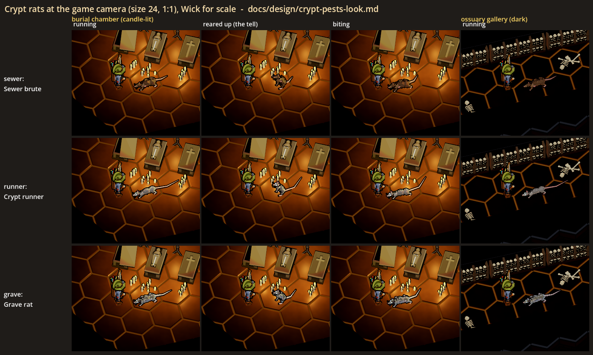
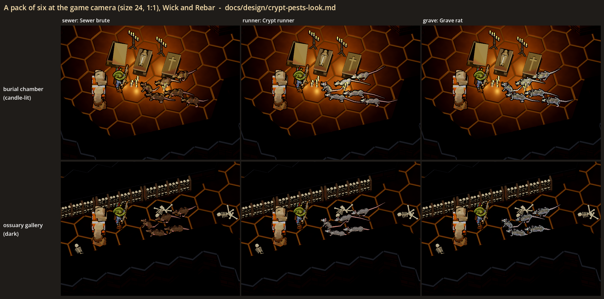
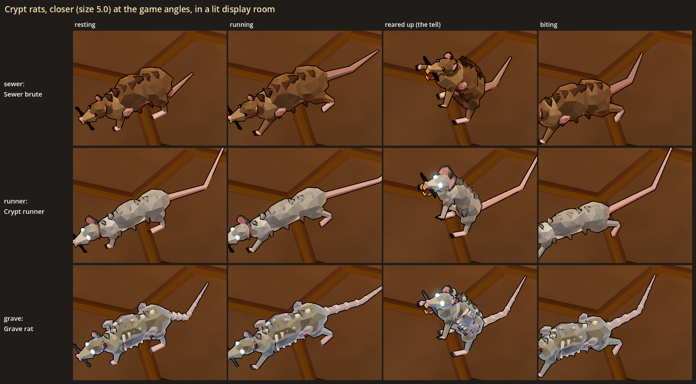
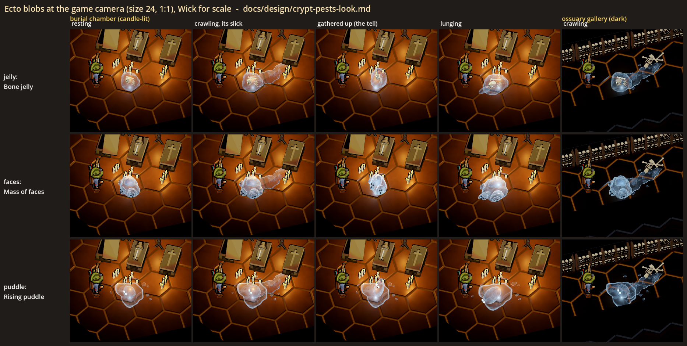
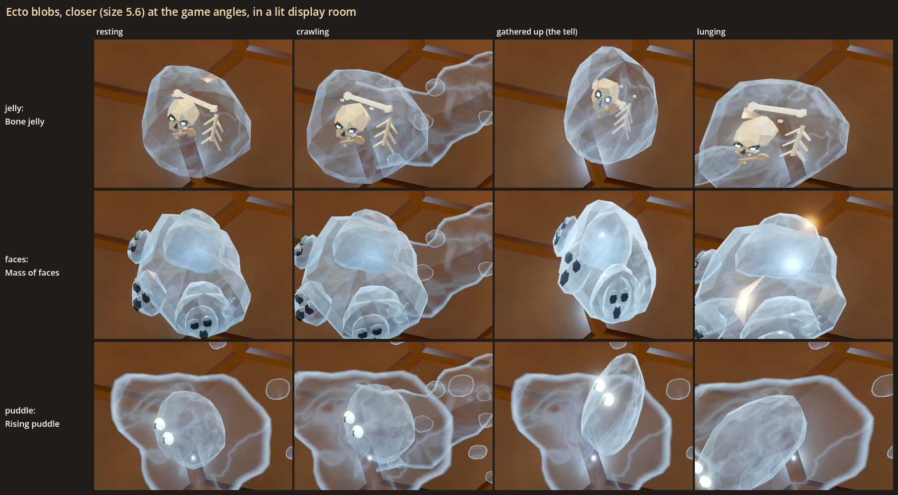
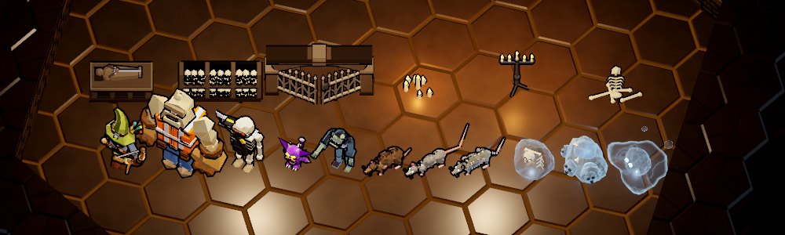

# Crypt pests: the crypt rats and the ecto blob (a visual test)

Status: **[look-dev only]**, 2026-10-31. Nothing here is in the game. No contract, floor, monster, world object or network
message uses it: the rats and the blobs have no HP, no AI, no collision and no slick that does anything. The test exists in
the gym (`--gym`) and in a look lab, and its job is to help the user pick how two new haunted-contract enemies should look.

## The brief

The haunted roster (new-themes.md, "Ghost house: haunted contracts") is zombies, acolytes, possessed skeletons and armour,
wisps and the grimoire. The user (2026-10-31): "We will need to think of additional enemy types to [flesh] out the levels.
We only have skeletons and armor so far." Then: "In parallel, we can work out some additional enemy types like [ectoplasm]
monsters or maybe larger than average rats." That roster lacks a fast swarm and an area-denial pest, so the test proposes:

- **Crypt rats**: larger than average rats, about dog-sized next to a hero, in the **fast swarm** role (packs of 5-6, like
  the swarmer imp). They live in the crypt section (crypt-section.md).
- **The ecto blob**: a crawling mass of ectoplasm, slow, in the **area-denial** role: it leaves an ectoplasm slick behind it.
  Damp would wash the slick away and any hit could kill the blob (both proposals, nothing built). Its body and its slick use
  the ectoplasm look the user picked (ectoplasm-look.md, "film"), so the two read as one family.

Every name below ("Sewer brute", "Crypt runner", "Grave rat", "Bone jelly", "Mass of faces", "Rising puddle") is a
working label for the sheets and the gym, a proposal only; nothing player-facing is decided.

## What the user is choosing

1. **Which rat:** sewer, **runner**, grave, or a mix (for example the runner's body with some of the grave rat's mange).
2. **The rats' eyes:** glowing in the ghost colour (runner, grave) or dark beads (sewer).
3. **The rats' size:** as shown (hips 0.43-0.47, nose to rump about 1.2-1.3, a hero is 2.0), or smaller or bigger.
4. **The bite's tell:** the rear-up as shown, or a crouch-and-pounce. The rear-up reads clearly up close but only modestly
   at the game camera (a rat rearing up foreshortens from above); in a real build the monsters' wind-up tint would help it.
5. **Which blob:** **jelly**, faces, or puddle.
6. **The slick:** film (the ectoplasm the user picked, as shown) or slime (milkier, easier to see, closer to goo).
7. **The blob's own light:** on (a small cold pool round it, as shown) or off.
8. **The blob's size:** as shown (about 1.2 across, the puddle 1.9), or smaller or bigger.

The defaults (my picks, see "How they read") are in bold.

**The user's read (2026-10-31):**
- Which rat: "Sewer brute" (over the runner, the agent's pick). It keeps its dark bead eyes for now.
- Which blob: "Mass of faces" (over the jelly, the agent's pick). Its faces show only as dark specks at the game camera,
  so they need to read bigger or brighter when it is built.

## The rats

All three share one build (`RatModel`): a big rump, the back arched over the loins, a long tapering snout, round ears,
**orange incisors** (a rat's are), pink naked tail, ears and feet, an ink outline like every monster. Built about the size of
a dog: hips 0.43-0.47 off the floor, nose to rump about 1.2-1.3, and a tail of 0.8-1.5 on top.

| | **A. Sewer brute** (`sewer`) | **B. Crypt runner** (`runner`) | **C. Grave rat** (`grave`) |
|---|---|---|---|
| One line | the realistic rat, scaled up | lean, grey, long-tailed, with ghost-light eyes | a mangy, half-dead rat |
| Body | heavy and hunched (girth 1.22), thick neck, a coarse dark hackle down the spine | long and lean (girth 0.86), smooth back | medium, the fur in patches over raw grey skin, ribs and spine knobs through a sunken flank |
| Fur | brown | ash grey | dun grey |
| Tail | short and thick (0.78), dusky | very long and thin (1.5), pink | bare and bony (1.05), knobbed vertebrae |
| Ears | small | big, pink | one torn |
| Eyes | dark beads with a glint, no glow | the ghost colour, glowing; they flare in the tell | the ghost colour, glowing; they flare in the tell |
| Rim | none | none | the dead's rim (NecroLook, the zombies'), so it follows the gym's Necro rim switch |



`rats.png`: a row per rat at the game camera (size 24, 1:1), Wick for scale: running at him, reared up (the tell), biting,
all in the burial chamber's candle light, then running in the dark ossuary gallery. `rats_2x.png` is the middle of each
cell doubled (nearest).



`rat_packs.png`: a pack of six of each rat streaming in at Wick and Rebar, one rearing at Wick, in the chamber and in the
gallery.



`rats_close.png`: each rat resting, running, reared up and biting, closer (size 5, the game's angles) in the lab's lit
display room. Not how the game plays: it shows the models.

## The ecto blobs

All three share one build (`EctoBlobModel`): the ectoplasm made solid. **See-through** (the floor and what it has swallowed
show through it), glassy and lit (the room's lights give it a wet shine), **no ink outline**, glowing faintly in the ghost
colour, brightest on the facets that turn away from the view, a slow swirl of brighter veins inside, and a small cold light
of its own. It crawls slowly (a squash and stretch), and its tell is to gather up tall and lean back, flaring brighter,
before it throws itself forward, flat, with a pseudopod shooting out.

The **slick** behind it is a new builder in the ectoplasm look (`EctoplasmLook.trail`): the film ectoplasm (the user's pick)
as a ribbon along its path, 1.0 wide at the blob and narrowing to a point at its old end, droplets off its sides, the film's
bright rim and swirl, and its vapour. Damp's wash (`EctoplasmLook.set_wash`) works on it as on any ectoplasm.

| | **A. Bone jelly** (`jelly`) | **B. Mass of faces** (`faces`) | **C. Rising puddle** (`puddle`) |
|---|---|---|---|
| One line | a clear dome of jelly with bones in it | a lumpy heap of milky ectoplasm with faces pressing out | a puddle of ectoplasm that humps up, two eyes on the hump |
| Body | a dome about 1.2 across, 0.8 tall, very see-through (alpha 0.26) | a big lump with two smaller ones grown into it, denser and milkier (alpha 0.74) | the ectoplasm look's own film puddle (1.9 across) with a jelly hump 0.8 across |
| Its face | a skull suspended in it, its sockets glowing in the ghost colour; ribs, a thigh bone, loose teeth and a brass key around it | three faces pushing out (a bump with hollow dark eyes and an open mouth) and a hand | two glowing eyes with slit pupils on the hump |
| The tell | gathers up tall, leaning back, flaring | the same | the hump rears into a tall leaning wave |
| The lunge | thrown forward and flattened, a pseudopod out | the same | the wave falls forward, the sheet stretching after it |



`blobs.png`: a row per blob at the game camera (size 24, 1:1), Wick for scale: resting, crawling on its slick, gathered up
(the tell) and lunging at Wick in the burial chamber's candle light, then crawling in the dark gallery. `blobs_2x.png` is
the middle of each cell doubled.



`blobs_close.png`: each blob resting, crawling, gathered up and lunging, closer (size 5.6) in the lit display room.



`lineup.png` (`lineup_2x.png` doubled): Wick, Rebar, the grunt, the swarmer imp, the mourner zombie, the three rats and the
three blobs, for scale, at the game camera in the display room.

The stills freeze the swirls and the vapour (`EctoplasmLook.clock`, `EctoBlobModel.clock`). In the gym everything moves.

## How they read at the game camera (first impressions, for the user to overrule)

- **The rats read as rats at once**: a low, long body, the pink tail and the snout. Next to Wick they are dog-sized, clearly
  bigger than the swarmer imp and clearly lower than any other enemy, which suits a swarm that runs under the fight.
- **A pack of six** reads as a swarm, not as six enemies: a stream of tails. In the gallery the grey ones still read; the
  brown ones are the first to go.
- **Sewer brute:** the most realistic, but its brown is the vault's own warm brown: in candle light it is the hardest of the
  three to pick out, and in the dark it is a shape with pink feet. No glowing eyes means nothing to find in the dark.
- **Crypt runner:** the clearest at 1:1 in both lights (ash grey against warm stone), and the long pink tail is the best
  "rat" sign at a distance. Its glowing eyes tie it to the haunted family and make a pack in the dark a set of pale dots.
- **Grave rat:** the most "haunted" up close (ribs, bones, the rim), but at 1:1 its patchwork reads as noise: a speckled
  rat. The rim lifts it a little in the dark. As a rarer variant or a pack's leader it could work.
- **The rear-up** is the weakest read of the set at 1:1: from above, a rat rearing up gets shorter, not taller. The open
  jaw and (on the glowing ones) the flaring eyes help. Up close it is a clear threat pose.
- **The blobs never read as goo**: see-through, cool, no outline, against the goo's opaque chartreuse. They are the
  brightest things in the dark gallery, and their light makes a cold pool round them.
- **Bone jelly:** the clearest "creature": a glassy dome with a skull in it whose sockets glow is a face from across the
  room, and the bones say "it has eaten someone". It also reads as the ectoplasm family at once.
- **Mass of faces:** creepy up close, but at 1:1 the faces are dark specks on a pale lump. Denser and milkier, so it hides
  the floor more and reads less like the ectoplasm.
- **Rising puddle:** the most like area denial (it is mostly slick), but the weakest creature read: at 1:1 it is a pale
  patch with two small dots, and it is the hardest to tell from its own slick. That could be a feature (a puddle that is
  alive), but if any hit kills it, players need to see what to hit.
- **The slick** reads as a pale glassy smear behind the blob in both lights, with the film's bright edges. In the candle
  light it is faint in the middle (film is almost clear there); slime would be easier to see.
- **The tells:** the blob gathering up tall and flaring is easy to see; the puddle's rearing wave is the biggest motion of
  the three.

**My picks:** the **Crypt runner** and the **Bone jelly**. The runner is the best read in the crypt's two lights and fits the
family through its eyes; the jelly is the clearest creature, its skull is its face, and it is unmistakably ectoplasm.

## The sheets

All in `docs/design/crypt_pests_look/`. The game views are at the game camera (yaw 45, pitch -56, orthographic size 24,
1920x1080) at 1:1 game pixels, staged in the crypt section lab's **vault** set (crypt-section.md): the **burial chamber**
(candle-lit: its sarcophagi, candelabras and floor candles, plus two small candle clusters of this lab's) and the
**ossuary gallery** (no light: the vault's dark, warm ambient). Each sheet fits a 1920x1080 window.

| File | What |
|---|---|
| `rats.png`, `rats_2x.png` | each rat running, reared up, biting (chamber) and running (gallery), Wick for scale |
| `rat_packs.png` | a pack of six of each rat at Wick and Rebar, chamber and gallery |
| `rats_close.png` | each rat in its four poses, closer, in the display room |
| `blobs.png`, `blobs_2x.png` | each blob resting, crawling on its slick, gathered up, lunging (chamber) and crawling (gallery) |
| `blobs_close.png` | each blob in its four poses, closer, in the display room |
| `lineup.png`, `lineup_2x.png` | the crew, the grunt, the swarmer imp, the mourner, the rats and the blobs for scale |

## What was built

All of it is cosmetic only: plain nodes with no HP, no AI, no collision and no networking. Shapes come from fixed seeds; the
gym's loop phases and slick seeds come from `GameWorld.fx_rng`. Shaders use `ShaderHash.GLSL`.

| Piece | Where | What |
|---|---|---|
| `RatModel` | `scripts/art/lowpoly/crypt/rat_model.gd` | A `MonsterModel` with three variants (`SPEC`). Parts: body (pivots at the hips), head, jaw, tail, tail2 and four legs aimed at their feet every pose. `apply_idle` crouches and sniffs, or gallops (a bound: the pairs reach and gather, the back flexes, the tail streams); the tail is posed in world angles so long and short tails both lie on the floor. The wind-up rears it up (paws up and spread, jaw open, the glowing eyes flaring); the swing is the bite. |
| `EctoBlobModel` | `scripts/art/lowpoly/crypt/ecto_blob_model.gd` | A `MonsterModel` with three variants. Its body is a faceted dome (or heap) in its own see-through jelly shader (lit, a fresnel, a swirl, near-black paint as dense hollows, `flare` for the tell), no outline; what it has swallowed is opaque under it; the puddle's sheet is `EctoplasmLook.puddle("film")`. A small `OmniLight3D` in the ghost colour. Crawl, wind-up and lunge as above. |
| `EctoplasmLook.trail` | `scripts/art/lowpoly/ghost/ectoplasm_look.gd` | New, additive: a slick along a path in any ectoplasm variant, in the ectoplasm group, washable. The rest of the ectoplasm look is unchanged. |
| `CryptPest` | `scripts/art/lowpoly/crypt/crypt_pest.gd` | One gym figure: a kind, a variant and a pose, looping live (a rat gallops a line and back, rears and bites on a loop, or six run round a loop; a blob rests, crawls a line over its slick, or gathers and lunges on a loop), or holding a still (`pose_still`). In `GhostLook.GROUP`, so the Ghost colour (and Necro rim) redress it. |
| The gym | `GymSpawns` group `crypt` (**Crypt and ectoplasm (look test)**) | Eighteen buttons: "rat (sewer \| runner \| grave): run / bite / pack" and "ecto blob (jelly \| faces \| puddle): rest / crawl / lunge" (keys `pest:<kind>:<variant>:<pose>`). A pack spawns three cells clear of the next. |
| The lab | `scripts/art/lowpoly/crypt/crypt_pests_lab.gd`, `scenes/crypt_pests_lab.tscn` | Extends the crypt section lab (its vault set and dressing) and renders the sheets above. |
| Test | `tests/test_crypt_pests.gd` | The gym entries; every rat headless (its parts, cheap, dog-sized, its eyes and rim, feet and tail on the floor at rest, the gallop moving its feet, reared up with its head high and jaw open on its hind feet, the bite lunging); every blob (its parts, see-through with no ink in the ghost colour, its light, the crawl, the tell's gathering and flare, the lunge and pseudopod; ecto green follows the ghosts); the slick (in the ectoplasm group, no ink, narrowing, washable); the gym spawns (cosmetic, looping, a pack of six, the crawler's slick, the Ghost colour redressing them live); the lab's builders headless. |

The real monsters, `MonsterDefs`, `MonsterFactory`, the floor generator and the contracts are unchanged. Nothing outside the
gym and the lab creates a rat or a blob.

## Running it

```powershell
.\run.ps1 --gym --no-mic          # the panel: Crypt and ectoplasm (look test) > rat (...) / ecto blob (...)
```

The sheets need a real window (not `--headless`):

```powershell
$env:CAST_GODOT = "<abs path>\Hero-Reader\third_party\godot\Godot_v4.7-stable_win64_console.exe"
& $env:CAST_GODOT --path . --resolution 1920x1080 -- --scene res://scenes/crypt_pests_lab.tscn --shot "<abs path>\docs\design\crypt_pests_look\rats.png" [--set rats|packs|blobs|close|lineup]
```

This writes every sheet next to `--shot` (about 15 s). `--set` renders one group only.

## If they are built (not designed yet)

Not part of this look-dev. Both would be host monsters (the swarmer's and the zombie's shape); the rats a pack kind the crypt
deals (a habitat, as the goo imp's sewer). The slick is the open question: a timed area every machine draws from the
blob's path, like the goo patch (a host-arbitrated runtime object) or a scheduled effect, with its effect (a slow, a slip,
a small damage), its life, and Damp washing it to be decided. It needs the networking checklist (`networking.md`) first.

## Choices made for the test (the user may want a say)

- **The rats are animals, not the dead**, except the grave rat. They belong to the crypt, like the goo imp to the sewer.
- **Orange incisors and pink tails, ears and feet** on all three: the "rat" read at a distance.
- **The rats keep the monsters' ink outline**; the blobs have none (ectoplasm has none, ectoplasm-look.md).
- **The blob takes the ghost colour** (GhostLook.colour, like ectoplasm), so one switch sets the ghosts, the ectoplasm,
  the blobs and the glowing rats' eyes.
- **The blob has its own small light** so it can be found in the dark parts of a crypt.
- **The slick is the film**, the ectoplasm the user picked; slime is the alternative if it needs to be easier to see.
- **The tells**: a rat rears up, a blob gathers up tall; both flare (the glowing eyes, the jelly) in the tell.
