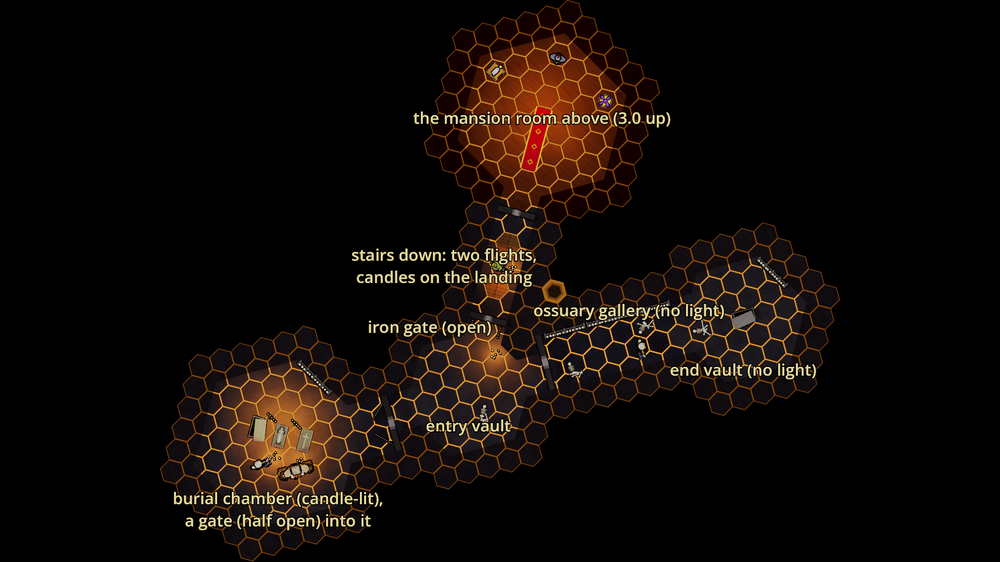
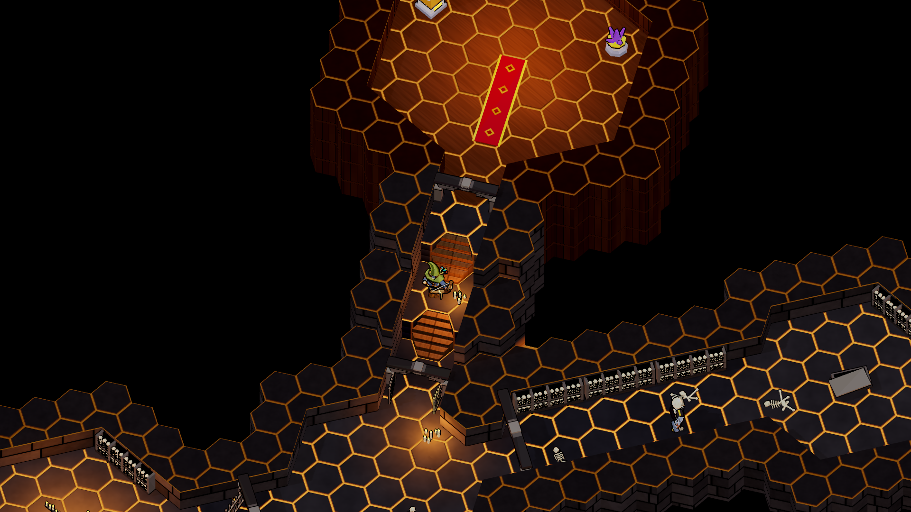
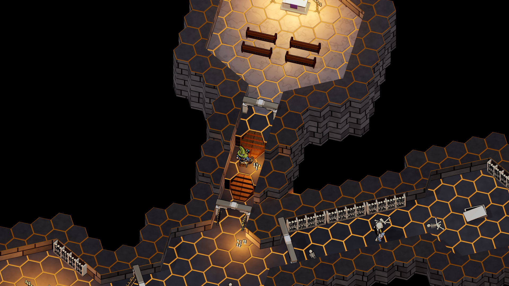
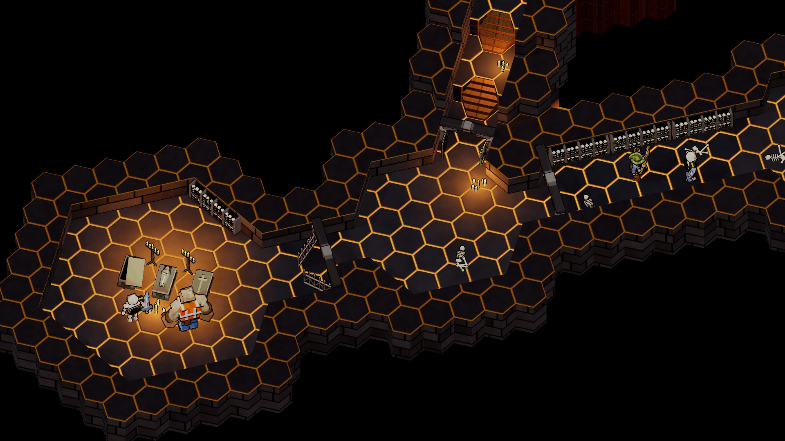
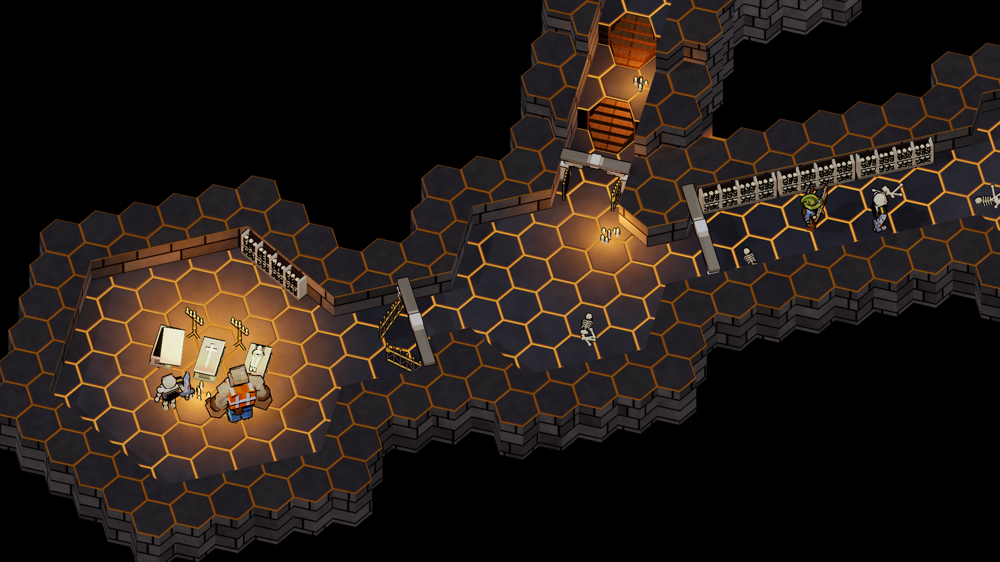
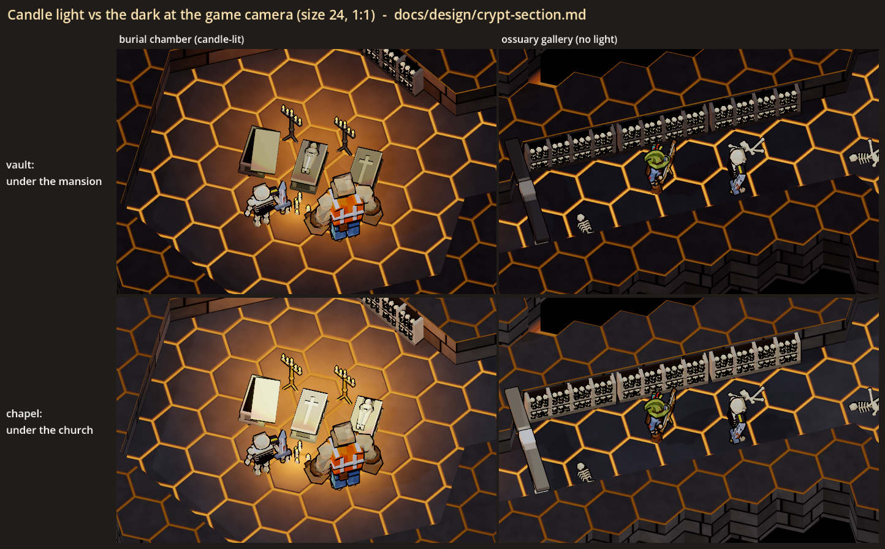
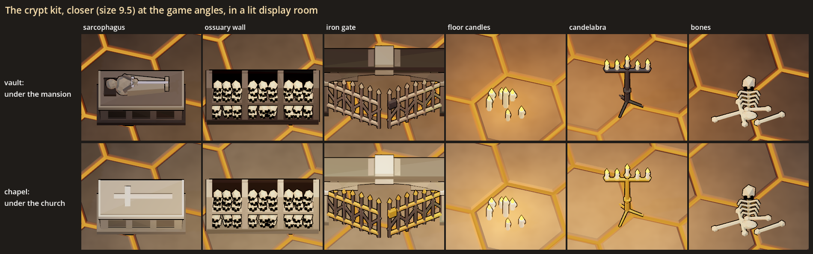

# The crypt section: a visual test

Status: **[look-dev only]**, 2026-10-29. Nothing here is in the game. The floor generator never makes a crypt, and no site,
contract, monster or network message knows one. The test exists in a look lab and, as loose pieces, in the gym. Its job is
to help the user decide how a crypt should look as a section of a floor.

The idea this serves (new-themes.md, "Ghost house: haunted contracts", Sites): a haunted site is a room pool plus a
section pool, and the crypt is the section that a mansion ("sections: crypt, sewer") or a church ("section: crypt") can
roll. Like the sewer clusters and the lava caves, it would be a part of a floor with its own architecture and light. The
crypt's skeletons as possessed hosts are a separate test. This one is the architecture: walls, floor, sarcophagi, ossuary
walls of skulls and bones, iron gates and candles, and how the crypt meets the floor above.

## What the user is choosing

| Choice | Options | What it is |
|---|---|---|
| **Material set** | **vault**, chapel | **vault**: under a mansion. Dark rough stone blocks, brown-grey flags, black iron, tallow candles, sarcophagi with a stone effigy on the lid. **chapel**: under a church. Pale limestone blocks and flags, brass candlesticks, beeswax, sarcophagi with a relief cross |
| **The way down** | as shown | A stone arch in a wall of the room above, a narrow stair hall going down 6 levels (3.0) in two flights with a candle-lit landing, and an iron gate at its foot into the first crypt room |
| **Light** | as shown | The crypt has no daylight. Its bright parts are candle light only. The dark parts get only a dim, cool ambient |

The kit is the same in both sets: sarcophagi (effigy, cross or pushed-open lid), an ossuary wall (niches packed with
rows of skulls, its top open with one more row on it), an iron bar gate in a stone arch
(shut, half open or open), a plain stone arch, floor candles, a standing candelabra and a fallen skeleton. The church above also has
pews and an altar.

## The sheets

All the game views are at the game camera (yaw 45, pitch -56, ortho size 24) and at 1:1 game pixels. They use the game's
own drawing: a `HexMap` with levels, stairs and midpoint walls, `HexMapView` and `DungeonLook`. The crypt's materials are
recoloured rows of `FloorMaterials` (`CryptLook`).

The layout is the same in both sets:
- the room above, 6 levels up, at the top of the screen;
- the stair hall, coming down toward the camera;
- the **entry vault** at the foot of the stairs;
- to the left, through a half-open gate, the **burial chamber**: candle-lit, with three sarcophagi, two candelabras, floor
  candles and an ossuary wall;
- to the right, through an arch, the **ossuary gallery**: unlit, with ossuary walls down its far side;
- at the far end of the gallery, the **end vault**: unlit, with an opened sarcophagus.

Wick, Rebar and two grunts stand in for scale. The grunts are today's skeleton model, not possessed hosts.



`plan.png` is the vault set from straight above, turned the way the game camera is, with the parts named.



`section_vault.png` shows the mansion room above (wood boards, panelling, a red carpet to the crypt's door, the statue and
the lamp), the stone arch at the head of the stairs, Wick on the candle-lit landing, the open gate at the foot and the
entry vault.



`section_chapel.png` is the same, under a church: pale marble, pews and an altar with candles.



`crypt_vault.png` shows the crypt itself: the burial chamber on the left, the entry vault in the middle with the stairs
coming down into it, and the ossuary gallery on the right, with Wick and a grunt in the dark.



`crypt_chapel.png` is the same in the chapel set.



`light_dark.png` crops the candle-lit chamber and the dark gallery for each set, at 1:1. `light_dark_2x.png` is the middle
of each crop doubled with nearest-neighbour scaling.



`props.png` shows the kit closer (ortho size 9.5, the game's angles) in a lit display room, a row per set.

## How it reads at the game camera (first impressions, for the user to overrule)

- **Bright and dark read apart.** The burial chamber is a warm pool round the sarcophagi and candelabras. The gallery is
  clearly darker and cooler, but Wick, the grunt, the bone walls and the floor still read in it. The floor's amber hex
  seams carry a lot of the dark parts. If the user wants the dark parts genuinely hard to see, the ambient can go lower,
  but then the floor and the wall tops start to look alike.
- **The vault set** is the moodier of the two: brown-black stone with warm pools. In its dark parts it is close to black,
  with the seams doing the work.
- **The chapel set** reads better in the dark, because the pale stone holds what light there is. Its wall faces show the
  block courses clearly. Its candle-lit chamber is less dramatic, since pale stone under candles looks less like a crypt.
- **The way down** reads: the stone arch in the room above, the two flights with the landing's candles between them, and the
  gate at the foot. The room above, 3.0 up, stands like a block over the crypt, with its panelled or stone walls dropping
  to the crypt's level.
- **The ossuary walls** read as rows of skulls over packed bone ends, in the light and in the dark. At 1:1 a skull is a few
  pixels, so they read as a pale, dotted wall rather than as single skulls.
- **The sarcophagi** read as big pale stone chests. The effigy reads as a figure with a sword at size 9.5, and only as a
  pale lump at size 24. The pushed-open lid catches the candle light strongly.
- **Gates and arches** stand a little higher than the game's walls (1.78 against 1.5), so a doorway shows as a lintel over
  the wall line. The iron leaves are thin and dark, and an open gate is easy to miss at size 24.
- **Candles** read as small flames with a warm pool round them. The light pool, more than the candles themselves, is what
  tells you a part of the crypt is lit.

## What was built

All of it is cosmetic only: plain nodes with no HP, no collision and no networking. The shapes' jitter comes from fixed
seeds, and the gym's spawns draw theirs from `GameWorld.fx_rng`.

| Piece | Where | What |
|---|---|---|
| `CryptProps` | `scripts/art/lowpoly/crypt/crypt_props.gd` | The kit, in the house look (LowPoly soups, `MonsterMaterial`: ink outline, emissive flames). `build(kind, {set, ...})`: sarcophagus (`lid`: effigy / cross / ajar), ossuary (`width`, `height`; its back on a wall face), gate (`width`, `open`), arch, candles (`count`, `radius`, `seed`, `lit`, `light`), candelabra, bones, pew, altar. A lit piece carries an `OmniLight3D` named "CandleLight" (warm, short range, no shadow). Everything is in the group `crypt_look`. |
| `CryptLook` | `scripts/art/lowpoly/crypt/crypt_look.gd` | The two sets. `restyle(terrain, set)` gives one terrain its own copy of the material tables with the crypt's rows recoloured: `F_FLAGSTONE` (rooms), `F_CORR_STONE` (halls), `W_STONE` (walls), and for the chapel `W_CONCRETE` (the church's walls) and `F_MARBLE` (the church's floor). The shared `FloorMaterials` table is untouched. `relight(parent, set)` cuts `DungeonLook`'s key and fill to almost nothing and sets a dim, cool ambient. `downlight` is a warm pool for the room above. |
| The lab | `scripts/art/lowpoly/crypt/crypt_section_lab.gd`, `scenes/crypt_section_lab.tscn` | Builds the section (rooms and halls cut the way `DungeonGen` cuts them, the room above 6 levels up, two `STAIRS` cells, walls 3 levels over the highest floor beside them) in each set, dresses it and renders the sheets above. A display room off to the side holds the close-up pieces. |
| The gym | `GymSpawns` group `haunt` (**Haunting (look test)**) | "crypt: sarcophagus", "crypt: ossuary", "crypt: gate" and "crypt: candles" (lit) put a vault-set piece down. An ossuary within 3 of a wall backs onto it. There is no live crypt room in the gym: a whole section on the gym's map would be a big build, and the lab shows it. |
| Test | `tests/test_crypt_section.gd` | Checks that every kind builds in both sets as a cosmetic piece, with a candle light only on the lit kinds, and that an open gate swings toward +Z. Checks that the sets leave `FloorMaterials`' own tables alone, that the gym entries spawn (an ossuary onto a wall), and that the lab builds headless in both sets: the room above 3.0 up in its own materials, two flights of stairs, a path from the room above to the end vault, candle light over the chamber and none over the gallery. |

The floor generator, `FloorMaterials`, `HexMapView`, `DungeonLook` and the contracts are unchanged.

## Running it

```powershell
.\run.ps1 --gym --no-mic          # the panel: Haunting (look test) > crypt: sarcophagus / ossuary / gate / candles
```

The sheets need a real window (not `--headless`):

```powershell
$env:CAST_GODOT = "<abs path>\Hero-Reader\third_party\godot\Godot_v4.7-stable_win64_console.exe"
& $env:CAST_GODOT --path . --resolution 1920x1080 -- --scene res://scenes/crypt_section_lab.tscn --shot "<abs path>\docs\design\crypt_section\plan.png" [--set vault|chapel]
```

This writes every PNG above next to `--shot`. `--set` renders only that set's two game views.

## Choices made for the test (the user may want a say)

- **The way down is a stair hall**, like the sewer's option (a): a doorway in the room above and two flights down. It is not
  an elevator or a trapdoor. The crypt is 6 levels (3.0) below, like the sewer's stair.
- **The room above stands over the crypt**, so the crypt reads as being under it. A real floor would put the crypt's rooms
  wherever the generator likes.
- **Candle light is the only light** in the crypt. The key light is almost off, because its wall shadows made the floors
  darker than the wall tops. That makes the dark parts flat and cool rather than shadowed.
- **The walls are the game's height** (3 levels, 1.5), so the ossuary walls (1.45 plus the top row of skulls) fill a wall face and
  the arches (1.78) stand a little above it.
- **Gates**: the stair's gate is open, the chamber's half open. A shut gate would be the natural "locked crypt" beat, but it
  needs a design (a key, a lever, a shove).
- **An effigy in the vault, a cross in the chapel**, as the default lids. The pushed-open lid is in both sets as a hint of
  something having got out.
- **The church above** is pale marble with pews and an altar. The mansion above is the game's wood boards and panelling,
  with today's statue and crystal lamp. A suit of armour stands in the room's far corner, just out of the frame.

## The user's read (2026-10-29)

The kit, first pass. The user: "The sarcophogus should be a little smaller. It just takes too much of the room. The
ossuary - remove the top shelf and randomize the placement a bit more. The gates, they read _very_ dark when lit in the
scene. Anything we can do? The floor candles, the wax spill doesn't read, just leave the candles. The pillar doesn't add
anything. The bones are a little weak."
- **Sarcophagus** at 0.8 of its size (`CryptProps.SARC_SCALE`); the chamber's three moved closer together.
- **Gates** in worn iron (`gate`, `gate_hi` in the palette): mid-grey bars, lighter rails and finials (brass finials in
  the chapel), the bars a little thicker.
- **Candles** without the wax spill.
- **Pillar** gone from the kit and the section.
- **Bones**: a fallen skeleton (a bigger skull, a ribcage on a spine, a pelvis, thick long bones with fat knobs) instead of
  a thin scatter.
- **Ossuary**: the user also showed one placed across a wall's corner, half in the wall. A wall piece now goes on the
  nearest straight run of wall, centred on it and no wider than it (`_wall_run` in the lab).
  Then on the top: "I meant leave the top open. It can have a pile of skulls on it. Just no top board." And on the
  heap: "that is randomly in the air, not on the shelf. They should be laying on top of one another. The little dots
  also don't sell as skulls." So the niches are stacked the way a charnel house stacks them: bands of long bones laid
  lengthwise between rows of skulls facing out. A heap on the open top (skulls lying in the dips of the row below) gave
  way to the user's "Lets just try making the top row like the bottom two, just a slightly jittered row of skulls": the
  open top carries one more row of skulls. Asked what the white between the skull rows was (the long bones), the user:
  "Just skulls for now." The niches are rows of skulls only.

The two sets: "I want both a vault and chapel, but they are too similar to eachother." Open: how to set them apart.

