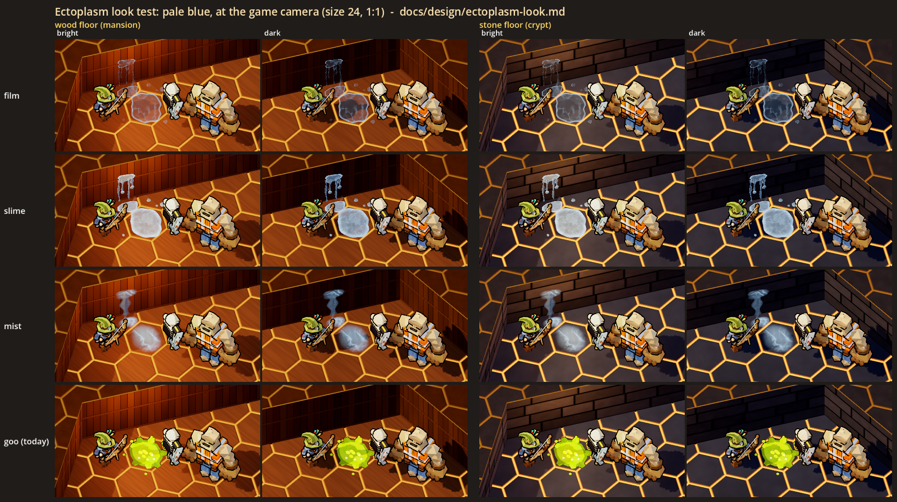
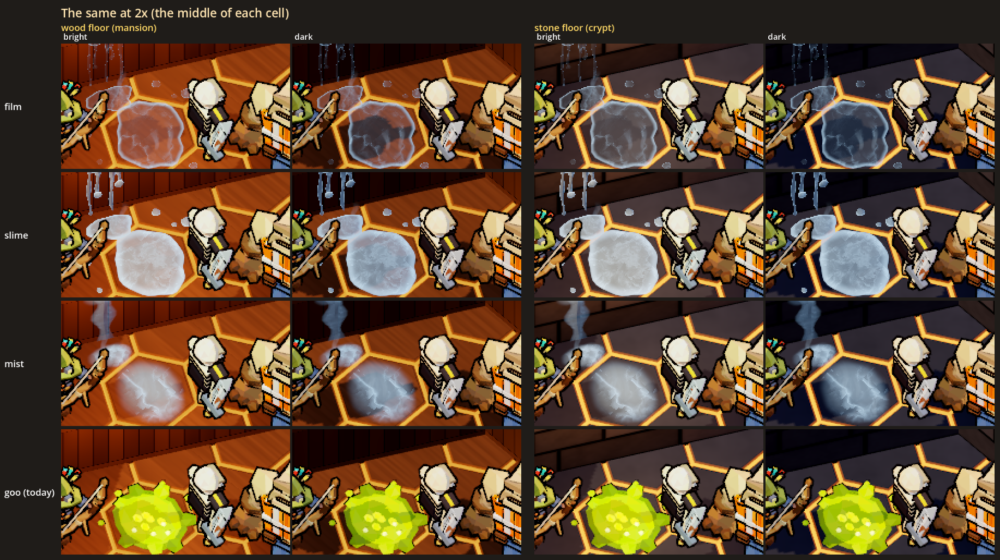
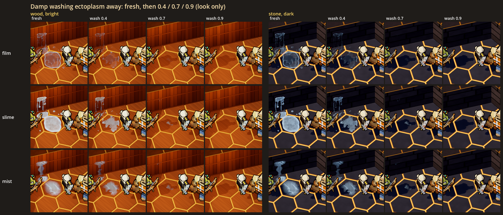
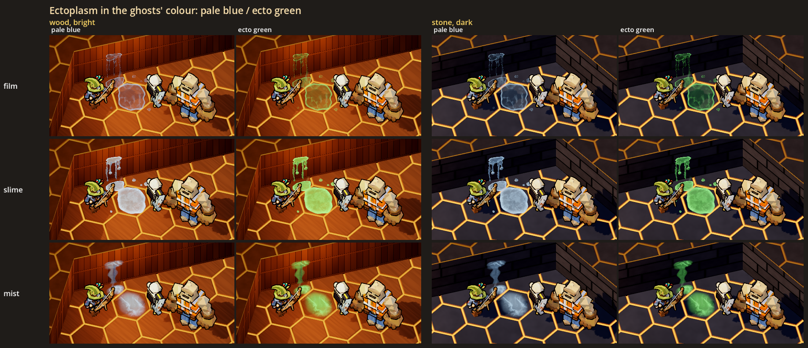
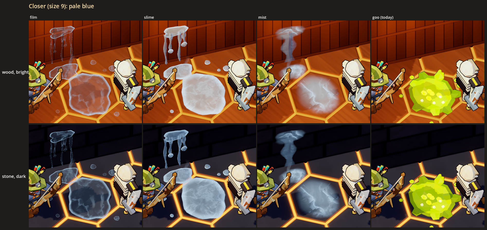

# The ectoplasm look: a visual test

Status: **[look-dev; the film is in the game since H3b]**, 2026-10-29. The ecto blob's slick (`EctoSlick`,
haunted-build-plan.md "H3b as built") draws with this look's film (`EctoplasmLook.trail`, `set_wash`) and is gameplay (a
slow, Damp washes it, networked). Everything else here (the puddles, the drips, slime and mist) is still look-dev: no slow,
no Damp hook and no gameplay state. The test exists in the gym (`--gym`) and in a look lab, and
its job is to help the user decide how ectoplasm should look.

The idea this serves (new-themes.md, "Ghost house: haunted contracts", Other enemies): **ectoplasm** is "the infestation
layer, like goo: it slicks or slows the floor, and Damp washes it away". It has to read as clearly **not goo** at the game
camera, since today's goo (the goo imp's patches, `GooSoups`) already slows the floor and Damp already washes it.

## The user's read (2026-10-29)

- **Ectoplasm is the film**: the thin glassy film with the bright rim and the glassy streaks down a wall (picked from film,
  slime and mist: "film").

## What the user is choosing

| Switch | Options | What it does |
|---|---|---|
| **Variant** | **film**, slime, mist | **film**: a thin glassy film, almost clear in the middle, with a crisp bright rim and splash droplets round it; thin glassy streaks run down a wall from a splash. **slime**: thicker and milky, with a raised meniscus and satellite blobs; heavy strings run down a wall and end in hanging drops. **mist**: a pool of low, clinging fog in soft stacked layers, with more vapour; one soft seep runs down a wall |
| **Colour** | **pale blue**, ecto green | Ectoplasm takes the ghosts' colour (`GhostLook.colour`, the same switch as the ghost look test), so a haunting's ghosts and its ectoplasm match |

The defaults are in bold. Everything else about the three variants is shared:
- **See-through.** The floor shows through. This is the main difference from goo, which is an opaque sheet.
- **Smooth and glassy.** It is a flat sheet with a bright edge and a wet shine from the lights. It has no lumps.
- **No ink outline.** Goo, the props and the monsters all have one.
- **Moving.** Bright filaments swirl slowly inside it, and thin wisps of vapour rise off it.
- **A faint glow in its colour**, so it still shows in the dark.
- **Damp washes it away.** It breaks up from its thin edge inward, thins to plain water, stops glowing and its vapour goes.

## The sheets



`sheet.png` is in pale blue, at the game camera (yaw 45, pitch -56, ortho size 24) and at 1:1 game pixels.
- The rows are the three variants and **today's goo** (a `GooSoups.patch` at the goo patch's size) for comparison.
- Each ectoplasm cell has a puddle on the floor and a drip down the wall behind it, ending in a small pool at the wall's
  foot. The goo has no wall drip.
- Wick stands on the left. A grunt stands at the puddle's right edge, and Rebar is behind it on the right.
- The columns are the **wood floor** (a mansion room: wood boards, wood panelling) and the **stone floor** (a crypt: corridor
  stone flags, rough stone blocks), each in a **bright** spot and a **dark** spot.
  - The bright spot is under one of the game's warm downlight pools.
  - The dark spot is the far end of the same wall, out of the pool.
- The rooms use the game's own drawing: midpoint walls, `HexMapView`, `DungeonLook` and `FloorMaterials`.



`sheet_2x.png` shows the same cells, cropped to the middle and doubled with nearest-neighbour scaling.



`strip_wash.png` shows each variant fresh, then Damp washing it away at 0.4, 0.7 and 0.9, on the wood (bright) and the
stone (dark).



`strip_colour.png` shows each variant in pale blue and ecto green, on the wood (bright) and the stone (dark).



`close.png` shows each variant and the goo at a closer camera (ortho size 9, the game's angle), on the wood (bright) and
the stone (dark).

The stills freeze the swirl and the vapour at one moment (`EctoplasmLook.clock`). In the gym they move.

## How it reads at the game camera (first impressions, for the user to overrule)

- **It does not read as goo.** Next to the goo row, all three variants are cool, pale and see-through, while the goo is a
  solid chartreuse lump with an ink edge. That holds on both floors and in both lights, and in ecto green too: the ecto
  green ectoplasm is a translucent mint, and the goo is an opaque yellow-green.
- **Film** reads as a wet glassy patch: the floor shows through the middle, and it shows mostly as its bright rim. It is the
  hardest of the three to notice on the warm wood in the bright spot, and it reads best on the dark stone.
- **Slime** is the easiest to see: a milky pale sheet that stands out on both floors. Its wall drip, strings ending in drops,
  is the most readable "drip" of the three. It is also the closest to goo in spirit (a thick puddle), but the colour and
  the see-through edge keep it apart.
- **Mist** reads as a soft glowing fog patch rather than a liquid. That is the most "ghostly", but the least like something
  that makes a floor slippery. Its wall seep reads more like a smoke column than a drip.
- **The wall drips** read at the game camera as pale streaks on the wall above the puddle. At 1:1 the film's streaks are only
  a pixel or two wide.
- **The dark spot** is only a little darker than the bright one on the wood. The game's lighting has no deep shadow on a wall
  that faces the camera, but the stone's dark spot is properly dim. All three variants glow enough to find in it.
- **Damp's wash** reads as the sheet breaking up into scraps and fading. By 0.7 almost nothing is left.

## What was built

All of it is cosmetic only: plain nodes with no HP, no AI, no collision and no networking. Each puddle's shape (its lobes,
its droplets, where its vapour rises) comes from a seed. The gym draws its seeds from `GameWorld.fx_rng`.

| Piece | Where | What |
|---|---|---|
| `EctoplasmLook` | `scripts/art/lowpoly/ghost/ectoplasm_look.gd` | The look. `VARIANTS` and their numbers (`SPEC`). `puddle(variant, radius, seed)` builds a floor puddle. `drip(variant, height, seed)` builds a wall drip: a splash high on the face, streaks down it and a pool at its foot. `set_wash(node, k)` is Damp washing it away. The sheet's shader is translucent and lit, so the room's lights give it a wet shine. It has a rim band, a soft edge, a domain-warped swirl with bright filaments, a faint glow and the wash's break-up. Each piece is a fan or ribbon whose UV.x runs from 0 in the middle to 1 at the edge. The vapour is camera-facing strips with noise scrolling up. Everything is in the group `ectoplasm_look`. |
| The gym | `GymSpawns` group `crypt` (**Crypt and ectoplasm (look test)**) | One button per variant, "ecto: film", "ecto: slime" and "ecto: mist". Each puts a puddle on the floor and, when there is a wall within 3, a drip on that wall, cut to fit under the wall's top (the game's walls are 1.5 high, the lab's 3). Puddles take the ghost colour that is set when they are put down. |
| The lab | `scripts/art/lowpoly/ghost/ectoplasm_look_lab.gd`, `scenes/ectoplasm_look_lab.tscn` | Renders the sheets above. |
| Test | `tests/test_ectoplasm_look.gd` | Checks that every variant builds a puddle and a drip in the group, see-through, with no ink and in the ghost colour. Checks that the drip runs up its wall and nothing reaches behind the wall face, that the wash reaches every piece, that the gym entries put ectoplasm down (and a drip by a wall), and that the lab's builders (its two rooms, their spots, a staged cell) run headless. |

The goo, `GooSoups`, `GooPatch`, Damp and the contracts are unchanged. Nothing outside the gym and the lab creates
ectoplasm.

## Running it

```powershell
.\run.ps1 --gym --no-mic          # the panel: Crypt and ectoplasm (look test) > ecto: film / slime / mist (near a wall for the drip)
```

The sheets need a real window (not `--headless`):

```powershell
$env:CAST_GODOT = "<abs path>\Hero-Reader\third_party\godot\Godot_v4.7-stable_win64_console.exe"
& $env:CAST_GODOT --path . --resolution 1920x1080 -- --scene res://scenes/ectoplasm_look_lab.tscn --shot "<abs path>\docs\design\ectoplasm_look\sheet.png" [--each <abs dir>]
```

This writes `sheet.png`, `sheet_2x.png`, `strip_wash.png`, `strip_colour.png` and `close.png` next to `--shot`. `--each`
also writes every cell's crop to the folder you give it; those are not committed.

## Choices made for the test (the user may want a say)

- **Ectoplasm takes the ghosts' colour** rather than having one of its own, so one switch sets both.
- **It glows faintly**, so it can be found in the dark. Goo glows too, so the glow is not what tells them apart: being
  see-through and having no ink outline is.
- **No ink outline**, on purpose: it lies on the floor like a liquid, not like an object.
- **Damp's wash is shown as a look only.** In the game, Damp removes a goo patch and leaves its own wet floor behind. The
  strip shows how ectoplasm could break up on its way out.
- **Size**: the puddle is about 0.9 in radius (the goo patch is 0.8), and the drip is 2.2 up a 3-high wall.
- **The crypt floor** in the lab is the game's corridor stone and rough stone blocks, not a new crypt material: the crypt's
  own materials are a separate test.
