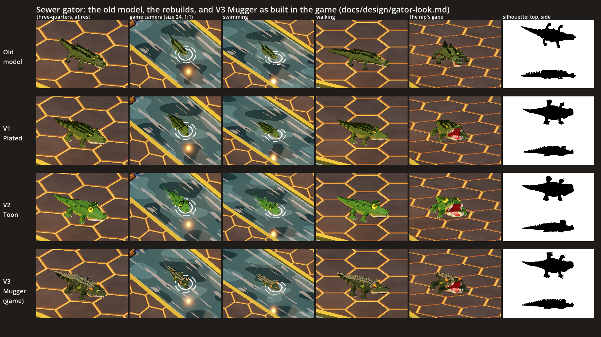
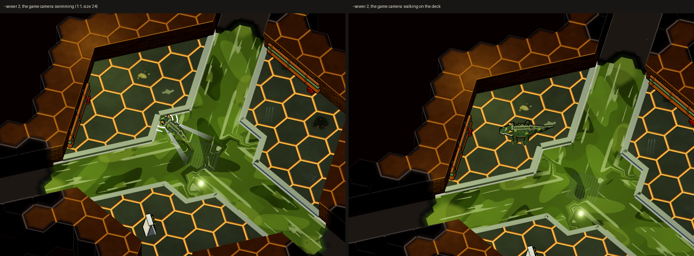

# The sewer gator's look

Status: **decided and built** (2026-10-20). The look-dev below (sections 1-4) was the proposal; section 0 records what the
user chose and section 5 what was built.

Look-dev after the sewer playtest (user, 2026-10-20): "So the gator doesn't quite have the low poly look. Lets take a
closer look at the shape and what might make it read alive versus the stiff point shape it is now."



`sheet.png` has a row per gator and these columns: three-quarters at rest, the game camera at 1:1 (size 24), swimming,
walking, the nip's gape, and the silhouettes from the top and the side. The bottom row is the game's gator as built.

## 0. Decided (user, 2026-10-20)

| Question | Decision |
|---|---|
| Which gator | **V3 Mugger** |
| Size | **Keep 1.3** (`Gator.GATOR_SCALE`: 3.0 long, the swim fit unchanged) |
| Motion | **The rigid-part rig** (section 4, option 2) |
| Story details | **Moss and the scar; no property tag** |
| The eyes | V3's small ember eyes got lost in the water: turned up so they read at size 24 from the water (the eyes, the nostrils and the knobs break the surface), without changing the character |



`game_final.png`: the game's gator in `--sewer 2` at the game camera, swimming out of the sump and walking on the deck
(`--sewer-demo gator`).

## 1. Why the old gator read as a stiff point

The old model is `SewerProps._gator` (still built, for the lava salamander and the old sewer labs), at `GATOR_SCALE` 1.3
in the game until 2026-10-20 (the sheet's and the strips' top row). Sizes below are in lab units, 2.3 long.

| Problem | What the model does | What you see |
|---|---|---|
| **A spindle planform** | The half width goes 0.09 at the snout, 0.32 at the shoulders, 0.035 at the tail: one smooth taper at both ends, with no notch at the neck | From above it is a lozenge that is pointed at both ends. The head never separates from the body, so there is no face. |
| **A plank for a head** | The skull is a flat box (0.24 x 0.07 x 0.42) and the jaw is a second box under it. The snout tapers to a point. | No brow, no cheeks, no jaw line. An alligator's head is a broad U with heavy jaw muscles; this one is a blade. |
| **Flat, thin body** | The body is overlapping ellipsoids 0.17 high against 0.32 wide, about half the height of the shark's (0.3 against 0.37). The pale belly band sits under the body where the camera never sees it. | It reads as a single olive slab with no mass and no weight on its legs. |
| **Twig legs** | The legs are 5-sided rods of radius 0.06 / 0.05, the hips 0.22 out and the feet 0.46 out | At the game camera only about 0.14 of foot shows past the body. From the side they look like stilts. |
| **Noise for scutes** | 22 thin frustum pins (0.07 x 0.06, up to 0.11 tall) in two rows plus one, all the same size | They read as a comb or a row of fence posts, not as armour. They are the only detail, so they become the silhouette. |
| **Small eyes** | The glowing slits are 0.05 x 0.03 boxes on small bumps | About 3 px at size 24. From the water the gator has no face. |
| **One value** | One olive, one dark, and the belly hidden underneath | No colour blocking, no tail bands, nothing for the eye to follow along the body. |
| **No secondary motion** | 10 baked meshes (5 bends x jaw shut / open). The bend is one circular arc, chosen from the turn rate. | It glides like a plank on land, because the legs never move. In water it turns rigidly with no S-wave. It has no breath, no head tracking and no gape beyond a box tilt. Everything that makes a reptile look alive (the tail lagging, the walk sway, the head moving on its own) is missing. |

## 2. What the liked creatures share (the style rules)

These come from reading `shark_models.gd`, `grunt_model.gd`, `brute_model.gd`, `swarmer_model.gd`, `pavise_model.gd`,
the goblin / Water Boy (`goblin_model.gd`, `cooler_carriers.gd`), and the kit in `low_poly.gd` and `monster_model.gd`.

1. **A few big faceted masses.** Each one is built from a handful of chunky primitives: jittered icospheres at detail
   0-1, frustums, slabs. Flat per-face normals and per-face painted jitter (`vary` 0.05-0.08) make the facets read.
   Nothing is thinner than a hand ("Chunky bones ... so it still reads from the steep game camera", grunt).
2. **Exaggerated proportions with a big head.** The shark's head ellipsoid (0.34 x 0.28 x 0.5) is as big as its body.
   The swarmer's head is wider than its body. The brute is all shoulders and fists.
3. **A face that reads at size 24.** Glowing ember or amber slits under a **heavy dark brow** (shark, grunt sockets), set
   at an angle for a mean expression. Teeth are few, oversized and bright against a dark or red mouth. Vertex alpha 0.5 is
   the monster glow (`MonsterMaterial`).
4. **Two or three colour blocks plus one hot accent.** A base, a dark accent (the shark's fin and spine stripe, the
   brute's plates) and a pale belly (counter-shading), plus one glow colour. The values are kept far apart.
5. **One signature silhouette tell visible from the iso camera.** The shark's bitten dorsal fin, the goblin's "T of ears
   over a fan of rockets", the swarmer's ears and spikes, the brute's horns, the pavise's door-sized shield. Nothing else
   on the floor has that top shape.
6. **One story detail.** The shark's scar, the grunt's badge and tabard, the brute's chain and suit trousers, the
   harness on the laser shark.
7. **Toon and ink.** `MonsterMaterial` gives toon bands, an amber rim and a 2.0-2.4 px inverted-hull ink outline (welded
   normals in CUSTOM0), with a baked top light in the vertex colour.
8. **Named rigid parts posed by sines.** There is a breath (`sin(t * 2)`), a stride, a head bob, a tail swing
   (`sin(t * 4.5) * 0.35`), a crouched wind-up and a snap on the strike. The shark is a three-segment follow-the-leader
   chain that bends along its path.
9. **Budgets.** Grunt 1500 triangles, swarmer 1000, Water Boy 1600, brute 2600, pavise 2800 (`MonsterDefs` "tris").

## 3. Three rebuilds

All three are lofted: a ring section is swept along a spine curve and skinned with flat faces. That gives clean big
planes, a flat belly and **automatic colour blocking** (top faces are the back colour, side faces the pale flank, bottom
faces the belly). On top of the loft each variant adds:

- a separate head and lower jaw, hinged;
- **a neck notch**: the cheeks are wider than the neck, which is narrower than the shoulders, so the head reads as a head;
- a blunt U snout with a raised nostril boss;
- chunky elbow-out legs with paws and pale claws;
- an overbite tooth row, with the big fourth lower tooth outside the snout.

The body keeps the swim fit from `sewer-concept.md`: 2.3 long in the lab (3.0 in the game at 1.3), half width 0.33 or
less (0.43 in the game), so `CLEAR` 0.48 and `R_TURN` 1.0 still hold. The legs stick out further than the body only while
it walks. In the water they fold back along the flanks.

| | V1 Plated | V2 Toon | V3 Mugger |
|---|---|---|---|
| Idea | The shark's language: crisp blocky planes | A big-headed character with readable eyes | An old armoured bruiser with a story |
| Section | 10 sides, flat belly, flat top | 12 sides, round | 10 sides, chiselled (vertex jitter 0.012) |
| Head | Wide cheeks, a step up to raised **eye turrets** with a dark brow wedge, a flat snout with a box nostril boss | **Bigger** (cheeks 0.285, 0.38 tall), short deep snout, fat round tip | Heaviest jowls (0.27), long and low, a brow **hood** of three dark spikes |
| Eyes | Big amber slit, tilted up and out so the game camera sees it, with a black slit pupil | **Domes** (r 0.11) with a wide glowing iris and slit pupil under a heavy half-closed lid | Small hot **ember** slit (the monster red) deep in the hood, with a pupil |
| Back | Nuchal bosses, four rows of keeled plates, then a **double tail crest** that runs into one | Two rows of soft dome bumps, a soft crest, dark spots | Four rows of tall **pale knobs** (osteoderms) against dark hide, a tall jagged crest |
| Colour | Olive back, yellow-olive flank, cream belly, **dark tail bands** | Bright green, yellow belly, dark-green spots | Dark moss, pale grey-green knobs, **algae patches**, dirty-cream belly, tail bands |
| Teeth | 7 pegs a side and the meshing lower row | 4 big square teeth a side and a cartoon underbite fang | 6 a side, one broken |
| Story | (none: it is the clean one) | (its face is the story) | A **yellow property tag** clipped through the tail base (it is billed property, $6,300) and a scar across the snout and brow |
| Silhouette tell | The zigzag of the double crest, the turrets | The two eye domes | The spiky knobbed ridge |
| Triangles at the proposal (one baked mesh) | 2676 | 2796 | 2852 |

The old model is 2376 triangles. The proposal's three were in the brute and pavise range (2600 / 2800).

What read at the game camera (the sheet's game-camera and swimming columns):

- **V2** read best. The two glowing eye domes are visible from the far side of a room, and it looks like a character.
- **V1** read as "a crocodile" at once: a blocky head with lit eyes, the plate rows and the banded tail.
- **V3** read as "armour, spiky" (the pale knobs carry it), but its small ember eyes got lost in the water (fixed in the
  build: section 5).
- **The old** model is a dark stick with a comb on it.

## 4. Motion that sells life

The rig takes the pose as numbers (`GatorModel` header). The strips show the motion in stills (the old model's row shows
what it could do: its five arc bends, and nothing for the walk):

| Strip | Frames | What moves |
|---|---|---|
| `strip_swim.png` | one S-wave cycle from above (water hidden so the whole body shows) | A **travelling S-wave** down the body (`wave` 36 degrees at the tail tip, `phase`), growing toward the tail. The head stays steady. The legs fold back. The head and neck rise so the nostrils, eyes and back break the surface. |
| `strip_walk.png` | half a gait cycle | **The high walk**: the belly lifts 0.1 off the floor, the legs move in diagonal pairs (right front with left hind) with a 0.6 stance and 0.4 swing and a 0.08 foot lift, the elbows out over the feet. **The trunk bows** toward the planted front foot and **the tail swings** a beat behind. |
| `strip_idle.png` | breath out, breath in, a jaw twitch looking one way, tracking the other way head up | **The breath** (the chest swells), **the jaw twitch** (`jaw` 0.18), **head tracking** (`head_yaw`, `head_pitch`). |
| `strip_nip.png` | watching, the wind-up, the gape, the snap | The head lifts, the jaws part, the full gape lifts the skull (most of a gape is the skull going up, so the chin never digs into the floor), then the snap lunges forward with the jaws shut. |

The three ways to build it in the game were (1) more baked poses (steppy, no head tracking), (2) **a rigid-part rig**
posed every frame like `SharkModels.pose` (chosen), and (3) a skinned mesh (smoothest, but the ink outline reads welded
normals from CUSTOM0 that skinning does not bend).

## 5. As built (2026-10-20)

**The model: `GatorModel`** (`scripts/art/lowpoly/monsters/gator_model.gd`), V3 Mugger with moss and the scar and no tag:

- **19 rigid parts**, each a MeshInstance3D whose mesh is built once per process and shared by every gator: the body cut
  along the spine into chest, hips and three tail segments; the head and the hinged jaw; for each leg the upper arm, the
  forearm and the paw. Each body segment reaches a little past its joints and the one behind starts at 0.9 of its size,
  growing back to full past the joint, so a bend never opens a gap and the overlaps never z-fight. One ShaderMaterial
  (`MonsterMaterial`) serves every part, so `Gator` drives the eye glow, the wind-up pulse and the hit flash as before.
- **Brighter eyes:** the ember is 1.45x the proposal's, a hotter orange (1.0, 0.42, 0.1) with a slit pupil, set out and up
  on its socket and with the brow spikes moved back so the game camera sees it over the water.
- **Trimmed to 2552 triangles** (from 2984 once split into parts): 3 toes, 3-sided teeth, 5-sided limbs, body rings every
  0.07 and no caps inside the joints. The read did not change. It is the pavise's budget range (2800).
- **The same size and swim fit:** 2.3 lab units at `GATOR_SCALE` 1.3, half width 0.43 in the game; `HEAD` and `SNOUT`
  unchanged.

**The motion: `Gator._pose_rig`** (`scripts/monsters/gator.gd`), cosmetic and LOCAL, from what every machine sees (its
state, facing, the wind-up, its speed, the water). Gameplay, timings and the networking shape are unchanged; the new look
vars are declared LOCAL in `net_fields()`.

| State | Motion |
|---|---|
| CALM | A lazy S (wave 16, about 0.12 cycles/s), a breath every 4 s (its phase from the spawn seed), a jaw twitch every 6-10 s (`GameWorld.fx_rng`), the head swaying a little |
| WATCH, RILED | The head turns up to 35 degrees toward the nearest body it watches (`_nearest_watched`), head up 6 degrees; eyes bright (as before) |
| Swimming (any state, in water) | The swim wave 16-32 degrees with its speed, the phase at 0.12 + 0.5 x speed cycles/s; legs folded back over 0.3 s; the V wake and the ripple as before |
| Walking (on land, moving) | The gait clock at 1.35 cycles per unit walked; belly up and legs stepping over 0.25 s as it starts, down as it stops; a small tail wave |
| NIP | The jaws part through the wind-up (`_telegraph`) to the gape, the head rising 6 to 16 degrees; open through the lunge; they snap shut fast after |
| RILED | The tail thrash in bursts: wave 40 at 2.5 cycles/s (it replaces the old bend wobble) |
| CHUM | Head down, the jaws working at 2 Hz |
| HELD | Head down, slower breath |
| DEAD | Belly up (as before; the rig holds its last pose) |

The body still curls with its turning (`bend`, up to 44 degrees). `Gator.model_for(bend, jaw, pose)` builds a posed
model for the z-fight registry (`ZFightModels`: every bend with the jaws shut and open, two walk frames and a swim
frame). `SewerProps` "gator" is unchanged and still used by the lava salamander and the old sewer labs.

**Screenshots:** `--sewer 2 --spells damp,fireball --no-mic --sewer-demo gator --shot <png> --shot-after S` sends the crew to
the landing, clears the staged monsters near the gator and makes it relocate at once with the camera on it. In layout 2
it swims out of the sump at about 1.5-2.5 s and walks on the deck at about 4-5 s (`game_final.png`: 2.4 s and 5 s).

## 6. Files

| File | What |
|---|---|
| `scripts/art/lowpoly/monsters/gator_model.gd` | `GatorModel`: the game's gator, the rig and its pose |
| `scripts/monsters/gator.gd` | `_build_visual` (the rig at `GATOR_SCALE`), `_pose_rig` (the motion), `model_for` |
| `scripts/art/lowpoly/zfight_models.gd` | The gator's poses in the z-fight registry |
| `scripts/app/dev/game_dev.gd` | `--sewer-demo gator` |
| `scripts/art/lowpoly/props/gator_looks.gd` | Lab-only: the looks as `GatorModel` specs (v1, v2; v3 is the game's), "current" = the old `SewerProps` model |
| `scripts/art/lowpoly/gator_look_lab.gd`, `scenes/gator_look_lab.tscn` | The lab: a `SewerLayouts.Builder` room with a 3.0 channel, `SewerView` "concrete", the shots, strips and sheet |
| `docs/design/gator_look/sheet.png`, `lineup.png`, `game_v3.png`, `strip_*.png` | The comparison sheet; the lineup (Wick, a grunt, the pool shark, then old, V1, V2, V3); the game's gator at the game camera in the lab; the motion strips (top to bottom: old, V1, V2, V3) |
| `docs/design/gator_look/game_final.png` | The game's gator in `--sewer 2` (above) |

The other renders (the per-variant close, water, walk, gape and silhouette shots, the game-camera shots of the other
looks, `lineup_game` and the swim and walk GIFs) are not kept in the repo: the lab writes them again (below).

## 7. How to re-render

```powershell
$g = $env:CAST_GODOT   # Godot 4.7 console exe
& $g --path . --resolution 1920x1080 -- --scene res://scenes/gator_look_lab.tscn --shot "$env:TEMP\gator_look\sheet.png" --frames "$env:TEMP\gator_frames"
# quick loop while modelling: --set close (close_* and sil_* only); also --set strips | lineup; --look brick | toxic
```

The lab writes every PNG next to `--shot` and prints the triangle counts (`tris <variant> <n>`). `--frames` writes the
swim and walk cycles (12 frames each) for GIFs; with PIL, for example:

```python
from PIL import Image; import glob
fs = sorted(glob.glob(r"%TEMP%\gator_frames\v3_swim_*.png"))
ims = [Image.open(f).convert("RGB").quantize(colors=128) for f in fs]
ims[0].save("swim_v3.gif", save_all=True, append_images=ims[1:], duration=90, loop=0)
```

The kept PNGs were shrunk with PIL: `game_v3` cropped to the middle 1280 x 720 at 1:1, `lineup` to 1280 x 720, the
strips to 1400 wide. `game_final.png` is two 880 x 620 crops (1:1) of `--sewer-demo gator` shots side by side.
