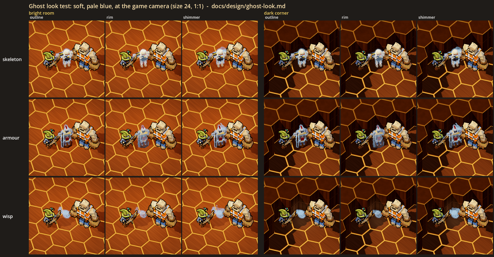
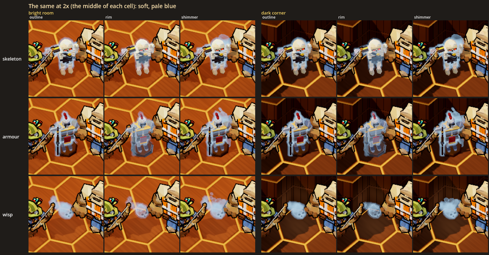
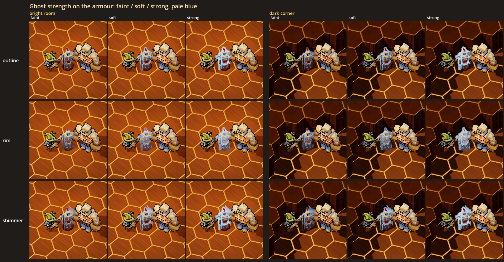
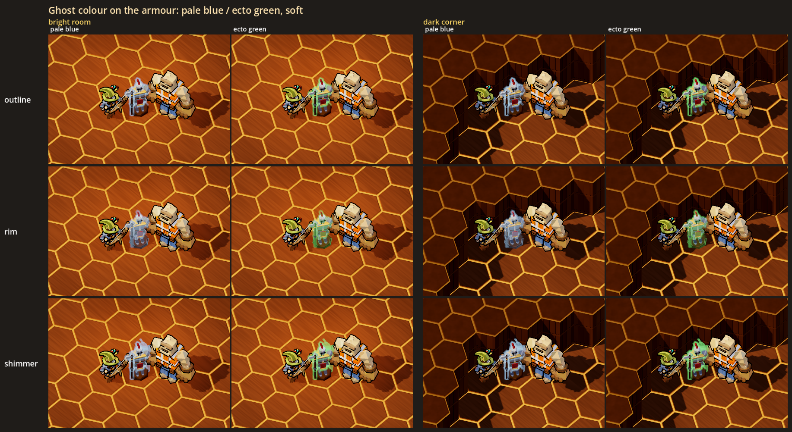

# The ghost look: a visual test

Status: **[look-dev only]**, 2026-10-28. Nothing here is in the game. No contract, floor, monster or network message uses it.
The test exists in the gym (`--gym`) and in a look lab, and its job is to help the user decide how ghosts should look.

The decision this serves (new-themes.md, "Ghost house: haunted contracts", Ghosts): ghosts should be **hard to see**, "a
soft outline on whatever they possess", and **a visual test comes first** ("Lets make sure to do a visual test on this").
The test covers the outline on a possessed host and a free ghost.

## What the user is choosing

Three switches, and each can be set separately:

| Switch | Options | What it does |
|---|---|---|
| **Look** | **outline**, rim, shimmer | **outline**: the host's ink outline is replaced by a soft, slightly blurred pale outline that pulses slowly. **rim**: the host's own edges glow (a faceted fresnel on its body), plus a faint outline. **shimmer**: the outline plus a faint afterimage of the host, offset up and to the right, drifting and wavering |
| **Strength** | faint, **soft**, strong | How hard the ghost is to see. At faint it is meant to be genuinely hard to spot. |
| **Colour** | **pale blue**, ecto green | The colour of the outline, the rim, the afterimage, the wisp and the wisp's light |

The defaults are in bold. Every ghost in the test follows the switches: two possessed hosts, **the skeleton** (today's
grunt model) and **the suit of armour** (a new blockout), and **the wisp**, a free ghost.

## The sheets



`sheet.png` is at soft strength in pale blue, at the game camera (yaw 45, pitch -56, ortho size 24) and at 1:1 game
pixels. Each cell has Wick on the left and Rebar on the right, both drawn with the normal ink outline.

- The rows are the skeleton, the armour and the wisp.
- The columns are the three looks, first in the **bright room** and then in the **dark corner**. The bright room is a wood
  floor under one of the game's warm downlight pools. The dark corner is the same room's far corner, outside the pool and
  shaded by the wall from the key light.
- The room uses the game's own drawing: wood boards and wood panelling (`FloorMaterials`), `HexMapView` and `DungeonLook`.



`sheet_2x.png` shows the same cells, cropped to the middle and doubled with nearest-neighbour scaling. It is easier to read
on a page, but use the 1:1 sheet to judge how hard a ghost is to see.



`strip_strength.png` shows the armour, with one row per look, at faint, soft and strong, in both lights (pale blue).



`strip_colour.png` shows the armour, with one row per look, in pale blue and ecto green, in both lights (soft).

The stills freeze the pulse and the shimmer's drift at one moment (`GhostLook.clock`). In the gym they move, and the
shimmer in particular reads much more clearly in motion than in a still.

## How the looks read at the game camera (first impressions, for the user to overrule)

- **Outline** reads most like "a soft outline on whatever they possess". At soft it is quiet in the bright room and glows
  clearly in the dark corner. At strong the halo frosts the whole figure. Like the ink outline, the halo is drawn round
  each part, so a little of it also shows inside the figure, for example between an arm and the torso.
- **Rim** changes the host itself rather than adding something round it. On the armour it looks glassy and haunted. On the
  bone-white skeleton it mostly makes the bones look whiter, which reads less as "possessed".
- **Shimmer** is the outline plus a doubled copy. In stills at soft the copy is a faint pale shape up and to the right. It
  reads better in the gym, where it drifts. At strong it can look like a rendering glitch.
- **Strength.** At faint the ghost is close to invisible in the bright room. One tell remains even at faint: a possessed
  host has no ink outline, while everything else on the floor does.
- **Colour.** Ecto green stands out much more against the warm amber floors and seams. Pale blue blends into the steel and
  bone, which makes it the harder of the two to see.
- **The wisp** is a translucent head with dark eyes and a small round mouth, and a tail that trails behind it. At soft it
  is clearly visible as a pale shape. At faint it is very hard to find, and it has no light. At soft and strong it casts a
  small light in its colour on the floor. Under rim, its tail puffs show as rings.

## What was built

All of it is cosmetic only: plain nodes with no HP, no AI, no collision and no networking. Their randomness (each ghost's
pulse phase and the wisp's starting point on its loop) comes from `GameWorld.fx_rng`.

| Piece | Where | What |
|---|---|---|
| `GhostLook` | `scripts/art/lowpoly/ghost/ghost_look.gd` | The three switches as static state (`pick`, `reset`), and the shaders. The host's body is the monsters' toon shader (`MonsterMaterial`) with a ghost rim added to it. The soft outline is three stacked translucent inverted hulls, built the same way as the ink outline (`LowPolyMaterial.OUTLINE_SHADER`); the widest is the faintest. The afterimage is a translucent copy pushed behind the body and offset in screen pixels. The wisp's body is a translucent, unshaded fresnel. `dress` hangs the chain for the current look off a body's shared material. `refresh_all` redresses every ghost in the tree. |
| `GhostBody` | `scripts/art/lowpoly/ghost/ghost_body.gd` | One ghost: `make("skeleton" / "armour" / "wisp")`. The skeleton is a `GruntModel` with every part in the ghost body; it idles on its own clock and stands still. The armour is an `ArmourModel`. The wisp drifts in a slow figure eight round where it was put down (1.6 wide, about 19 s a lap), bobbing. Its tail trails behind its heading with a sideways wave, and it carries a small light. Every ghost is in the `ghost_look` group. |
| `ArmourModel` | `scripts/art/lowpoly/ghost/armour_model.gd` | A suit of armour on a wooden plinth, built with LowPoly soups in the house look: tarnished steel in three values, brass trim, one faded crimson accent (the plume and the tabard), and one silhouette tell, a halberd planted on the plinth that stands taller than the suit. Its parts are named like a monster's, so a possessed suit could be posed later. |
| The gym | `GymSpawns` group `ghost`, `GymDev.experiments()` | Three spawn buttons under **Ghosts (look test)**: "ghost: skeleton", "ghost: armour" and "ghost: wisp". Three rows in **Experiments**: **Ghost look**, **Ghost strength** and **Ghost colour**, which apply live to every ghost in the gym. `--gym-act ghosts` puts one of each in a row in front of the player, for screenshots. |
| The lab | `scripts/art/lowpoly/ghost/ghost_look_lab.gd`, `scenes/ghost_look_lab.tscn` | Renders the sheets above. |
| Test | `tests/test_ghost_look.gd` | Checks that the three gym entries spawn cosmetic ghosts, that each switch changes the material parameters on every ghost (the rim, the shell alphas, the colours, the afterimage pass, the wisp's alpha and light), that the wisp drifts, that a real grunt still wears `MonsterMaterial` and its ink, and that the lab's builders run headless. |

The real grunt, `MonsterMaterial`, `LowPolyMaterial`, `MonsterDefs` and the contracts are unchanged. Nothing outside the
gym and the lab creates a `GhostBody`.

## Running it

```powershell
.\run.ps1 --gym --no-mic                      # the panel: Ghosts (look test) to spawn, Experiments > Ghost look / strength / colour
.\run.ps1 --gym --no-mic --gym-act ghosts     # one of each in front of you as the gym opens
```

The sheets need a real window (not `--headless`):

```powershell
$env:CAST_GODOT = "<abs path>\Hero-Reader\third_party\godot\Godot_v4.7-stable_win64_console.exe"
& $env:CAST_GODOT --path . --resolution 1920x1080 -- --scene res://scenes/ghost_look_lab.tscn --shot "<abs path>\docs\design\ghost_look\sheet.png" [--each <abs dir>]
```

This writes `sheet.png`, `sheet_2x.png`, `strip_strength.png` and `strip_colour.png` next to `--shot`. `--each` also writes
every cell's crop to the folder you give it; those are not committed.

## Choices made for the test (the user may want a say)

- **The ink is gone on a possessed host.** The brief was to replace it, so the soft outline takes its place.
- **The halo outlines each part**, the way the ink does, so some of it shows inside the figure as well as round it.
- **The wisp has a face**: two dark eyes and a small round mouth. Without them it read as a puff of smoke.
- **The wisp lights the floor** at soft and strong, with no light at faint. The light makes it much easier to find in the
  dark.
- **The armour**: a great helm with a crimson plume, a faded crimson tabard and a halberd. A different silhouette tell
  would change how it reads from across a room.
- **The pulse** runs about one cycle every 5 s, ±30 % alpha and a little width.
- **The dark corner** uses the game's own lighting: a wall shadow outside the downlight pool, not a specially darkened
  light. The sewer and the lava caves light rooms differently, and those were not tried.
