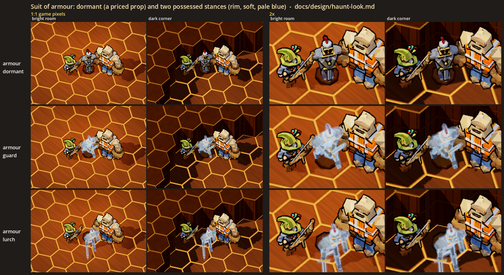
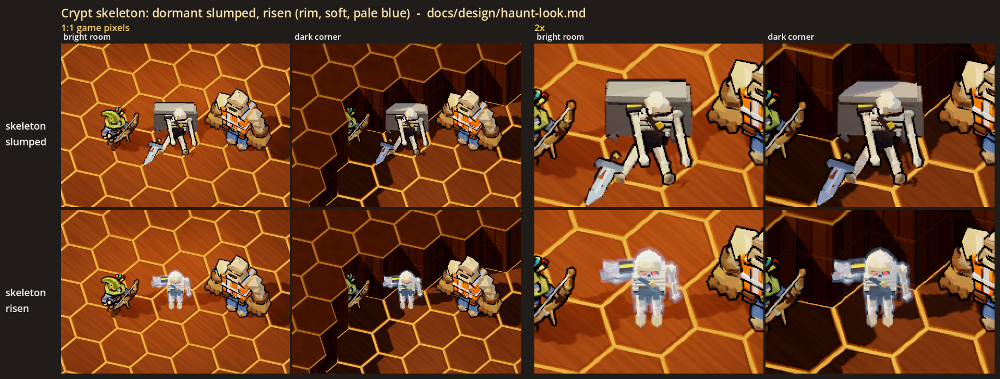
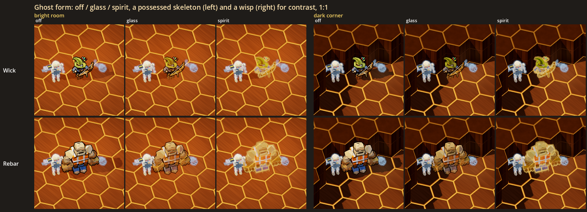
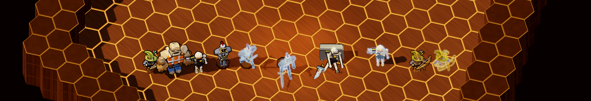
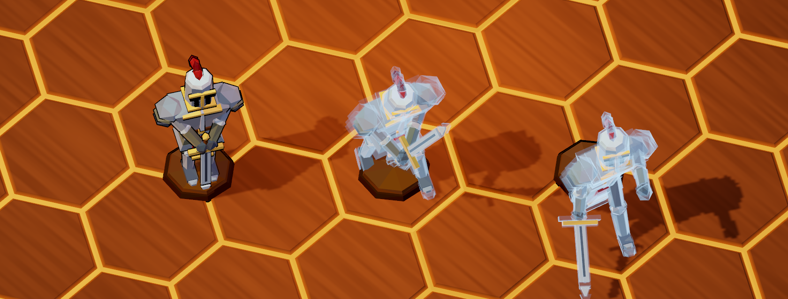
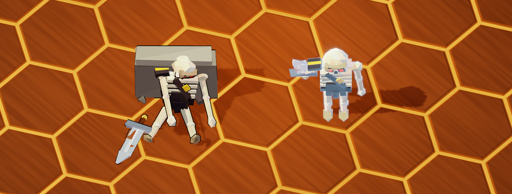
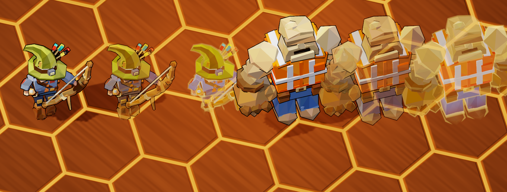

# The haunt look: possessed hosts and ghost form (visual tests)

Status: **[look-dev only]**, 2026-10-29. Nothing here is in the game. No contract, floor, monster or network message uses it.
The tests exist in the gym (`--gym`) and in a look lab, and their job is to help the user decide how the haunted contract's
hosts and the hero's ghost form should look.

They follow on from the ghost look test (`ghost-look.md`), where the user picked the rim look ("The rim look is really good.
Especially as a wisp."). Every ghostly thing here wears the **rim** look, at the default soft strength in pale blue. The
decisions they serve are in new-themes.md, "Ghost house: haunted contracts", Ghosts: a ghost possesses a host (a suit of
armour, a skeleton), and ghost form is a whole-body transform you cast on yourself ("For now").

## The user's read (2026-10-29)

- **The possessed knight did not read as possessed** with the rim alone: "This does not read as being possessed by a ghost."
  The rim only tints the steel; what the user liked on the wisp was its steamy body ("The wisp itself looked kind of
  steamy").
- **The ghost wears the suit**, picked from three ideas (steam leaking out, the ghost showing round it, the armour turning to
  steam): "The ghost shows around it. A faint, larger wisp-like body overlaps the armour, as if the ghost is wearing it."
  Built: every armour part again, 1.2 times larger round its own middle, in the wisp's vapour (`HauntPiece.vapour`), so it
  follows the pose. The user: "Fine for now. I'll want to see it animated." To do: the possessed knight moving (today it
  holds a still stance; only the pulse moves).
- **The niche is dropped for now.** The single niche "doesn't read" (it looked like a free-standing box). A wall of stacked
  burial slots was tried next and also failed ("No, that isn't working"): at the game camera it still read as a chest in
  the middle of the room. The user: "Drop the niche for now." The dormant skeleton is slumped only, and the risen one stands
  on its own. Burial slots belong in the crypt section, cut into its real walls. The sections below still describe the
  niche as first built.

## What the user is choosing

| Test | Options | What to judge |
|---|---|---|
| **Suit of armour** | dormant; possessed **guard** or **lurch** | Does the dormant suit read as a priced antique, and does each possessed stance read as "that thing is alive now"? Which stance? |
| **Crypt skeleton** | dormant in a **niche** or **slumped**; possessed **risen** | Do the dormant bones read as set dressing and the risen one as a threat? Which dormant pose, or both? |
| **Ghost form** | **glass** or **spirit** (or off) | Does the hero still read as your own character, and clearly not as an enemy ghost? Which treatment? |

The armour is the reworked `ArmourModel` with the two changes the user picked: a knight's silhouette, and a sword held
point-down with both gauntlets on the pommel. As agreed, there is no glowing visor and no glowing joint gaps.

## The sheets

All of them are at the game camera (yaw 45, pitch -56, ortho size 24), in the ghost look lab's room: a wood floor under
one of the game's warm downlight pools (**bright room**) and the same room's far corner in the wall's shadow (**dark
corner**). Wick stands on the left and Rebar on the right of each subject, both with their normal ink.



`armour.png`: a row per stance: dormant, guard and lurch. The first two columns are 1:1 game pixels in the bright room and
the dark corner. The last two columns show the same at 2x (the middle of the cell, nearest-neighbour).



`skeleton.png`: the same layout for the skeleton: in its niche, slumped against a stone block, and risen in front of its
empty niche.



`ghost_hero.png`: Wick and Rebar off, in glass and in spirit, in both lights, at 1:1. A possessed skeleton (rim) stands on
their left and a wisp (rim) floats on their right, so the hero's ghost form can be compared with the enemy ghosts.
`ghost_hero_2x.png` shows the same at 2x.



`lineup.png`: everything in one row at 1:1 for scale: Wick, Rebar, a grunt, the armour's three stances, the skeleton's
three, and Wick in glass and in spirit.





The close-ups are at the game's angle, zoomed in (size 7): the armour's three stances, the skeleton's three, and Wick and
Rebar off, in glass and in spirit. The stills freeze the rim's pulse (`GhostLook.clock`, `GhostForm.clock`). In the gym
it moves, and the risen skeleton idles.

## How they read at the game camera (first impressions, for the user to overrule)

- **The dormant armour reads as a prop.** It has the steel, the brass, the crimson plume and the ink outline, like every
  other priced prop on the floor. The possessed suits are the clearest "it's alive" in the set, because they lose the ink
  and gain the pale rim. At 1:1 in the bright room, the change from dormant to possessed is obvious.
- **Guard** stays on its plinth, so its shape is close to the dormant one. What changes is the sword: raised point-up
  diagonally across the body. The leaning stance and lowered helm show more in the 2x than at 1:1.
- **Lurch** has the stronger silhouette. The empty plinth is left behind and the knight stands on the floor in front of it,
  hunched, one gauntlet reaching and the sword held low, point leading. At the steep camera, the hunch and the reach
  foreshorten. It reads as "coming at you" more than as "hunched".
- **The skeleton in its niche** reads as bones on a shelf at 2x. At 1:1 it is a small pale cluster in a dark slot, which
  suits set dressing. The niche is only a blockout (a stone block with a recess, a dark cap like the game's wall tops, and
  masonry joints), standing on its own. The real crypt section will set the niche into a wall.
- **Slumped** is the most readable dormant pose. A sitting skeleton with its skull dropped and its sword on the floor
  beside it reads at 1:1 in both lights.
- **Risen** is today's grunt standing in the rim look, its ember eyes lit, in front of its empty niche. Against the bone
  white, the rim mostly makes the skeleton look paler and glassier (as ghost-look.md found). The empty niche behind it does
  a lot of the storytelling.
- **Ghost form: glass** keeps the hero's own look and lighting at about half opacity, with a warm gold rim and a
  translucent ink outline. It is clearly Wick or Rebar, and clearly not an enemy: enemies are cold blue and have no ink.
  Over the orange wood, though, the floor shows through and warms everything. Wick's blue jacket goes lilac-brown at 1:1.
- **Ghost form: spirit** makes the hero's own colours glow from inside. The legs fade out toward the floor, a soft warm
  halo replaces the ink, and there is no shadow. It is the more "ghostly" of the two and stands out more in the dark
  corner. Wick's green hat and Rebar's orange vest still read, and the warm gold halo keeps it apart from the cold rim
  enemies. Because it glows, a crowd of ghost-form heroes could get busy.
- **Both treatments draw the hero as one shape.** A part behind another part (an arm behind the body) does not show
  through it, so the figure does not turn into a jumble of overlapping translucent pieces.

## What was built

All of it is cosmetic only: plain nodes and materials with no HP, no AI, no collision and no networking. The only
randomness is the rim's pulse phase, which comes from `GameWorld.fx_rng`.

| Piece | Where | What |
|---|---|---|
| `ArmourModel` stances | `scripts/art/lowpoly/ghost/armour_model.gd` | `pose(stance)` with `STANCES` = dormant, guard, lurch. Rigid parts: the body and legs move and turn, each one-piece arm is aimed at its hand's spot (stretched a little to reach it), and the sword is laid along its line. The dormant pose is the model as it was. |
| `HauntPiece` | `scripts/art/lowpoly/ghost/haunt_piece.gd` | One piece: `make(kind)` for `armour_dormant`, `armour_guard`, `armour_lurch`, `skeleton_niche`, `skeleton_slumped` and `skeleton_risen`. A dormant piece wears the props' material and ink (`PropModels.material()`, as a priced prop does), with the skeleton's eyes out. A possessed piece wears the ghost body (`GhostLook.body_material`) and is always dressed in the rim look. It follows the gym's Ghost strength and Ghost colour pickers but ignores its Ghost look picker. The plinth is never possessed. The skeleton is today's `GruntModel`, posed lying, slumped or standing (idling). It brings its own blockout: a niche (lying, risen) or a stone block (slumped). |
| `GhostForm` | `scripts/art/lowpoly/ghost/ghost_form.gd` | `apply(model, "glass" / "spirit" / "off")` puts a hero model in ghost form or takes it out. Each part's material becomes a chain: a depth-only pass drawn before any colour (so the figure is one translucent shape), the hero's toon body (its own vertex colours, `LowPolyMaterial`'s light) made translucent with a warm rim, and then a translucent ink hull (glass) or `GhostLook`'s soft shells in warm gold (spirit). It is a node under the model that dresses new meshes each frame (a rebuilt arm, a held item; a mesh with another material is only made see-through), keeps the spirit's feet fade at the model's feet, and copies the model's own grey-out (downed). `off` puts every material back. |
| The gym | `GymSpawns` group `haunt`, `GymDev` | Six spawn buttons under **Haunts (look test)**, one per `HauntPiece` kind (a skeleton's niche or block faces the camera). One row in **Experiments**: **Ghost form** (off / glass / spirit), which puts the player's own hero in ghost form live and keeps it through a character switch. `--gym-act haunts` puts one of each piece in a row in front of you, for screenshots. |
| The lab | `scripts/art/lowpoly/ghost/haunt_look_lab.gd`, `scenes/haunt_look_lab.tscn` | Renders the sheets above. It extends the ghost look lab and uses that lab's room, lights and sheet layout. `--view turn` renders every piece from the front, the side and the back at eye level, which is useful while posing. Those renders are not committed. |
| Test | `tests/test_haunt_look.gd` | Checks the stances (the sword's point on the plinth, raised point-up, low and leading off the plinth, each right gauntlet on the grip), that dormant pieces are props with ink and possessed ones are rim ghosts without it (the plinth excepted), that ghost form redraws every part, keeps the hero's colours with a warm edge, takes the held item, and puts everything back on off, the gym's six entries and the Ghost form picker, and that the lab's staging runs headless. |

The real grunt, the heroes' own materials, `GhostLook`, `GhostBody`, `MonsterDefs` and the contracts are unchanged.
Nothing outside the gym and the labs creates a `HauntPiece` or a `GhostForm`.

## Running it

```powershell
.\run.ps1 --gym --no-mic                      # the panel: Haunts (look test) to spawn, Experiments > Ghost form
.\run.ps1 --gym --no-mic --gym-act haunts     # one of each haunt piece in front of you as the gym opens
```

The sheets need a real window (not `--headless`):

```powershell
$env:CAST_GODOT = "<abs path>\Hero-Reader\third_party\godot\Godot_v4.7-stable_win64_console.exe"
& $env:CAST_GODOT --path . --resolution 1920x1080 -- --scene res://scenes/haunt_look_lab.tscn --shot "<abs path>\docs\design\haunt_look\armour.png"
```

This writes every sheet above next to `--shot`.

## Choices made for the tests (the user may want a say)

- **Dormant pieces are drawn exactly like priced props** (the props' material and ink). There is no other tell, so a
  possessed antique can sit among real antiques unnoticed until it moves.
- **The plinth stays a plain prop** when the suit is possessed: the ghost is in the armour, not the stand.
- **Possessed pieces are always rim**, whatever the gym's Ghost look picker says, because the user picked rim.
- **The lurch holds its sword point-forward.** A sword dragged behind it was tried first, but at the steep camera the drag
  hid behind the body and read as a sword pointing sideways.
- **The dormant skeleton's eyes are out** (no ember glow), but their red paint still shows faintly in the niche close-up.
  The risen skeleton keeps the grunt's ember eyes, the enemy's tell.
- **The niche and the stone block are blockouts** standing on their own (the crypt section is built elsewhere). The niche
  is shallow so the game camera sees its whole shelf, and its top is dark like the game's wall tops. A pale top outshone
  the bones.
- **The hero's ghost colour is warm gold** (`GhostForm.WARM`), on purpose the opposite of the enemy ghosts' cold pale
  blue or ecto green. The crew colours were not used: Wick's crew blue is too close to the enemies' pale blue.
- **Glass keeps the shadow and the ink; spirit drops both** and fades its legs. Losing the shadow and the feet is a
  classic ghost tell, but it also makes the hero harder to place on the floor.
- **Ghost form is cosmetic on one model.** Nothing on the `Hero` changes, and nothing is networked. In co-op, the real
  version would be a status every machine draws on that hero.
