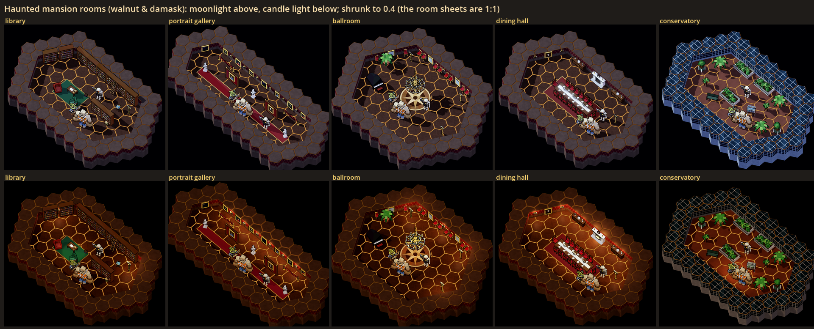
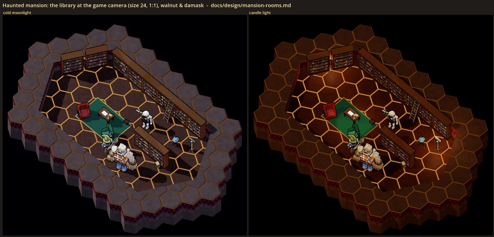
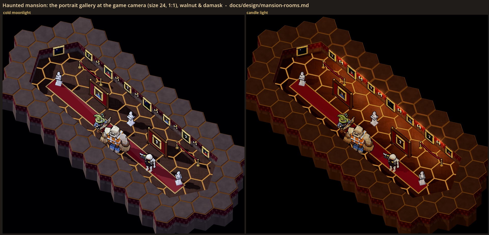
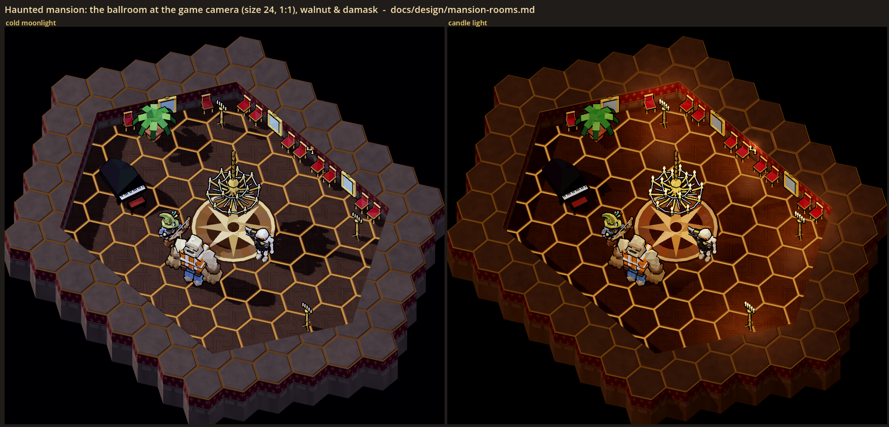
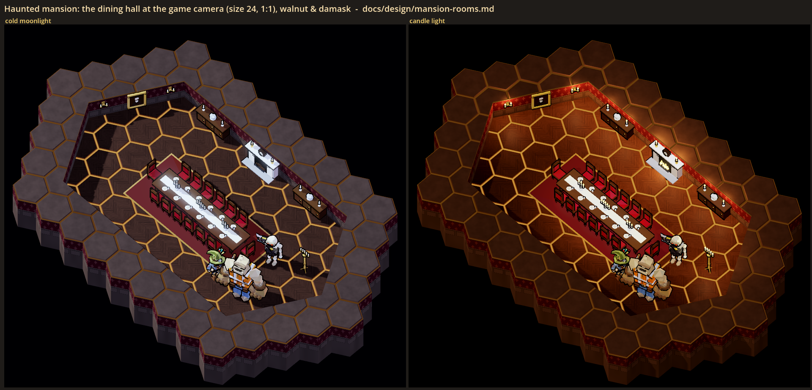
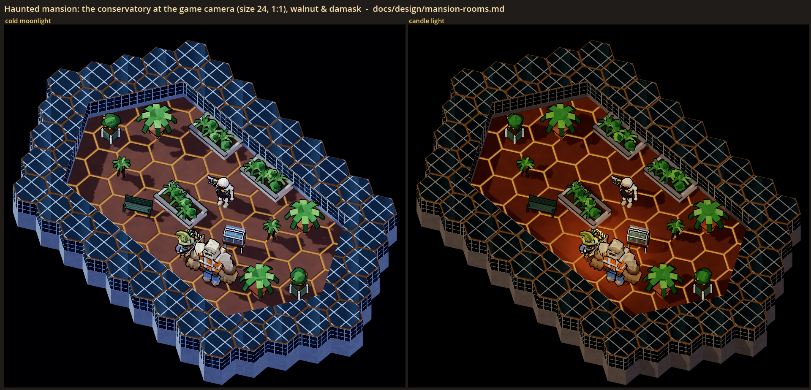
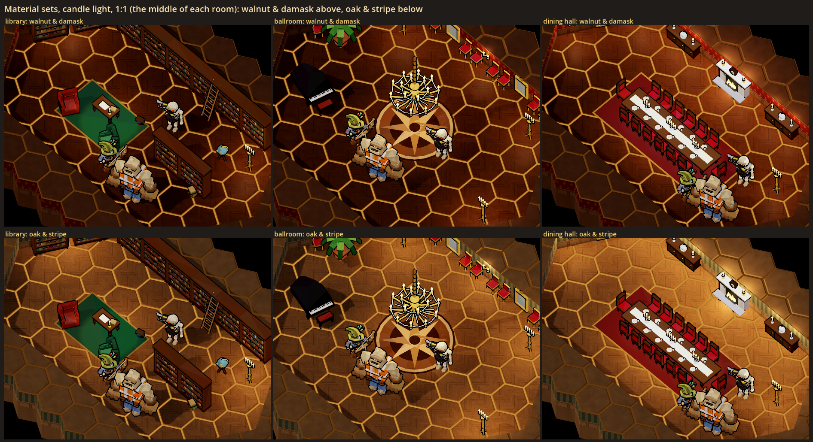
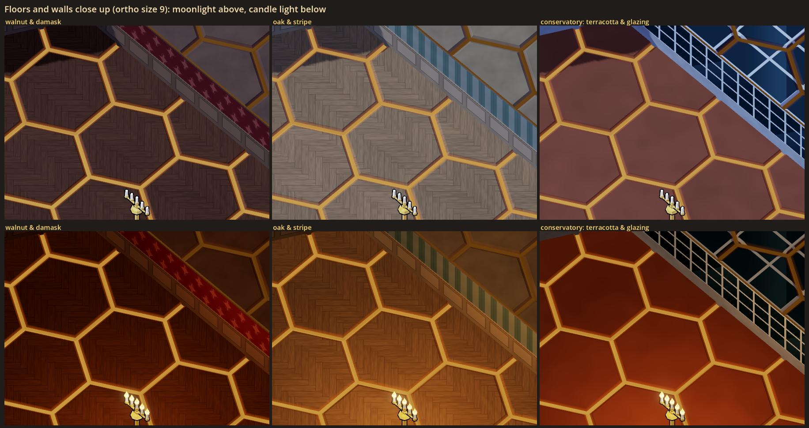
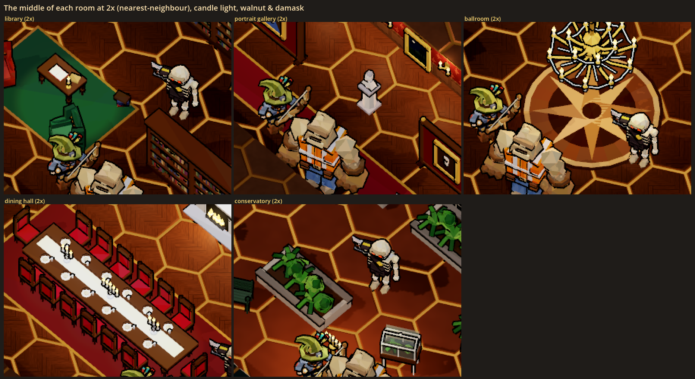
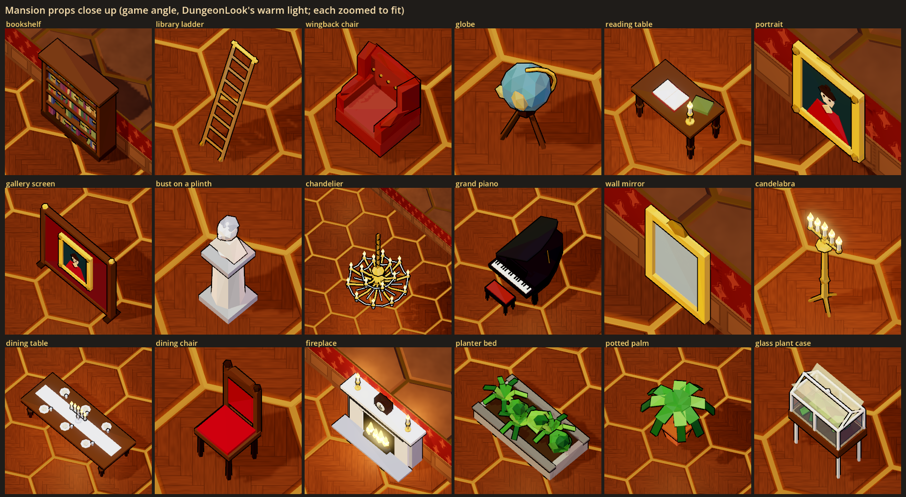

# Haunted mansion rooms: a visual test

Status: **[look-dev only]**, 2026-10-29. Nothing here is in the game. No room theme, site, floor, planner, contract or
network message uses it. The test lives in a look lab and in the gym, and its job is to help the user decide how a haunted
mansion's rooms should look.

The decision this serves (new-themes.md, "Ghost house: haunted contracts", Sites): a haunted mansion is a room pool of
**library, portrait gallery, ballroom, dining hall**, the existing wine cellar, and perhaps a **conservatory** (which could
later carry the parked garden theme's pollen beds). The church rooms are a separate, lighter test: `church-rooms.md`.

## What the user is choosing

| Choice | Options | What it changes |
|---|---|---|
| **Material set** | **walnut & damask**, oak & stripe | The house rooms' floor and walls. **Walnut & damask**: dark walnut herringbone parquet; oxblood damask wallpaper over a dark walnut panelled dado. **Oak & stripe**: pale oak herringbone; faded sage-and-cream striped paper over an oak dado. The conservatory keeps its own terracotta tiles and glazing in both. |
| **Light** | cold moonlight, candle light | **Moonlight**: a cold blue key light low from one side with long wall shadows, cool ambient, the warm downlight pools off, every candle out. **Candle light**: near dark, the pools off, every candle, candelabrum, sconce, chandelier and the hearth lit, each cluster with its own small warm light. |
| **Which rooms** | the five below | Whether each one reads as itself from the game camera, and which are worth building. |

Bold is the set the room sheets use. The lights are not a default: the user picks one, both, or one per room.

## The sheets

All shots are at the game camera (yaw 45, pitch -56, ortho size 24) at 1:1 game pixels unless the caption says otherwise.
Every room has Wick, Rebar and a grunt standing in it for scale. The rooms use the game's own drawing: a hex map with
DungeonGen's 3-level walls cut to midpoint lines (`HexMap.cut_walls`), `HexMapView`, `DungeonLook`.



`sheet.png`: every room in moonlight (top) and candle light (bottom), walnut & damask, shrunk to 0.4. Use it to compare;
judge from the 1:1 sheets below.



`library.png`: bookshelves along the back and left walls, a library ladder hooked on a brass rail, two free-standing
shelves, a reading table on a green rug with an open book (blank pages) and a candlestick, a wingback chair, a green
armchair, a globe, book stacks, a standing candelabrum and a wall sconce.



`gallery.png`: seven portraits in gilt frames along the back wall (alternating tall and small) with sconces between them, a
moonlit landscape on the end wall, two free-standing display screens with a portrait on each face, three busts on
plinths, a long runner, two velvet rope barriers.



`ballroom.png`: a two-ring chandelier hung from the dark above a parquet medallion (an eight-pointed star), gilt chairs
along the walls, two tall mirrors, a grand piano, standing candelabra in the corners, a palm. The rest is open floor.



`dining.png`: a long table (6 units) with a linen runner, place settings and three silver candelabra, fourteen high-backed
chairs, a marble fireplace with a fire (out in moonlight), a mantel clock and candlesticks, two sideboards with a tureen,
a tall portrait and sconces on the end wall, a carpet under the table.



`conservatory.png`: terracotta tiles inside glazed walls (white iron bars over dark glass; the tops of the walls are drawn
as a glass roof, so the glasshouse reads from above), three raised planter beds, potted palms, fern stands, a glass plant
case (a Wardian case), two orange trees in Versailles tubs, an iron garden bench, a candelabrum.



`sets.png`: the library, the ballroom and the dining hall in both material sets (candle light, the middle of each room at
1:1).



`materials.png`: a back corner of each material set close up (ortho size 9), moonlight above and candle light below, so
the herringbone, the damask, the stripe, the dados and the glazing can be seen.



`sheet_2x.png`: the middle of every room doubled with nearest-neighbour scaling (candle light, walnut & damask).



`props.png`: the key props close up (each zoomed to fit, in the game's warm light so their colours read).

## How the rooms read at the game camera (first impressions, for the user to overrule)

- **The dining hall reads best.** The long table, its white runner and the double row of red chairs are unmistakable even
  at 0.4, and the white fireplace on the back wall finishes it.
- **The ballroom reads once the floor says so.** Without the star medallion it was an empty room with chairs. With it, the
  chandelier above it and the chairs round the walls, it reads as a ballroom. The chandelier hangs in the air with no
  ceiling, like everything in this camera; its chain runs up out of the light.
- **The library reads** from the walls of books and the ladder. The back wall's shelves are seen almost edge-on, so the
  left wall's shelves and the two free-standing ones carry most of the books.
- **The portrait gallery reads** as long and lined with gilt frames. At 1:1 a portrait is a gold frame round a dark
  picture with a pale face, and the faces are only legible at 2x. The display screens help: they put pictures in the room,
  not only on the low wall.
- **The conservatory reads** mostly from the glazed walls and the green. The glass roof on the wall tops is the strongest
  "glasshouse" signal; without it the room was a plant room.
- **Moonlight vs candle light.** Moonlight is the more haunted of the two: cold, readable, with long shadows across the
  parquet. Candle light is warmer and cosier, and closer to the game's own look; in a big room it lights almost everything
  in amber, so it is less "dark house" than the word suggests.
- **The amber hex seams stay.** They are the game's floor lines; the test turns them down (seam gain 0.35, the wood floors'
  0.6) but in moonlight they are still the brightest thing on the floor.
- **Walls are low.** The game's walls are 1.5 units, so a wall's paper is a strip at the back of the room. The wall tops
  are a much bigger area than the faces, which is why the test colours them (walnut, oak, a glass roof) rather than leaving
  them as the papers' darker shade.
- **Walnut vs oak.** Walnut & damask is darker and more gothic; the parquet shows less in it. Oak & stripe is lighter
  and shows the parquet much better, but it reads more "country house" than "haunted".

## What was built

All of it is cosmetic: plain nodes with no HP, no collision and no networking. Variation (book colours, leaf angles,
orange positions) comes from a `seed` in the layout or else `GameWorld.fx_rng`.

| Piece | Where | What |
|---|---|---|
| `HauntLook` | `scripts/art/lowpoly/haunt/haunt_look.gd` | The lab-only materials and the two lights. Materials: rows written into the free slots 24-31 of a **copy** of FloorMaterials' shader table, and three patterns added to a **copy** of the terrain material shader (herringbone parquet; wallpaper over a panelled dado, as damask on walnut and stripe on oak; glazing), plus wall caps for them. `dress_terrain(view)` swaps the copies onto a built `HexMapView`. Lights: `apply_light(root, "game" / "moonlight" / "candle")` relights a DungeonLook scene (its environment, key and fill lights and downlight pools) and lights or snuffs every haunt candle. |
| `HauntProps` | `scripts/art/lowpoly/haunt/haunt_props.gd` | The kit: `build(kind, params)` makes a Node3D with an outlined `Body`, an optional see-through `Glass` and optional `Candles` (flames plus one small warm OmniLight per cluster). The shared pieces: painting (five pictures, no text), candlestick, candelabrum, runner, ladder. `gym_spawn` for the gym. |
| `MansionProps` | `scripts/art/lowpoly/haunt/mansion_props.gd` | 28 mansion props, each a LowPoly builder with its footprint row. |
| `HauntRoomLab` | `scripts/art/lowpoly/haunt/haunt_room_lab.gd` | The labs' shared base: a room as an elongated hexagon of hex cells with midpoint walls, its props from a layout (`wall_spot` puts a wall piece's back on the back or upper-left wall), the cast, the game-camera shot, the prop close-up, labelled sheets. |
| The lab | `scripts/art/lowpoly/haunt/mansion_rooms_lab.gd`, `scenes/mansion_rooms_lab.tscn` | The five room layouts and the sheets above. |
| The gym | `GymSpawns` group `rooms`, `GymDev.experiments()` | Spawn buttons under **Haunted rooms (look test)** for the key props (14 mansion and 4 church; a wall piece backs onto the nearest wall), and one Experiments row, **Haunt light** (game / moonlight / candle), which relights the whole gym live. There are no live rooms in the gym: building them there would mean a gym map change, so the lab carries the rooms. |
| Test | `tests/test_mansion_rooms.gd` | Every mansion prop builds headless inside its footprint with no text, wall pieces' backs on the wall line; the shader and table copies carry the test's rows while the game's are untouched; the lights snuff and light the candles and put DungeonLook's values back; the gym's haunt entries spawn cosmetic props and the Haunt light row works; every room in both sets builds in the lab with its materials, props and cast. |

`FloorMaterials`, `HexMapView`, `DungeonLook`, `RoomThemeDefs` and the wine cellar are unchanged.

## Running it

```powershell
.\run.ps1 --gym --no-mic       # the panel: Haunted rooms (look test) to spawn, Experiments > Haunt light
```

The sheets need a real window (not `--headless`):

```powershell
$env:CAST_GODOT = "<abs path>\Hero-Reader\third_party\godot\Godot_v4.7-stable_win64_console.exe"
& $env:CAST_GODOT --path . --resolution 1920x1080 -- --scene res://scenes/mansion_rooms_lab.tscn --shot "<abs path>\docs\design\mansion_rooms\sheet.png" [--only <room> | materials | props]
```

`--only library` (or any room id: library, gallery, ballroom, dining, conservatory) writes only that room's sheet.

## Choices made for the test (the user may want a say)

- **Herringbone, with faint joints.** The floors' rule since 2026-10-17 is no square joints or per-tile colour blocks (the
  hex seams are the only lines on a floor). Parquet is made of boards, so the test keeps the grain changing direction per
  board with only a faint joint; at 1:1 it reads as texture, not a grid. A plain-boards floor (the wine cellar's) is the
  fallback.
- **Wall caps are coloured.** The game draws a wall's top as its material's base at half brightness; here that made red
  and teal bands round every room, so the test's walls give their caps wood (and glass for the conservatory).
- **Portraits:** five pictures, each a dark ground, a pale oval face with two dark eyes, hair, a dark or coloured coat
  with a white collar; one is a moonlit landscape. No text, no plaques. The eyes are there so a haunting could light them.
- **Books** are plain coloured spines; some have a gilt band. No titles.
- **The chandelier has no ceiling to hang from.** Its chain runs up out of view (to 6.5), like the game's other tall
  things.
- **Candles are out in moonlight**, and a prop put down while the gym is in moonlight starts with its candles out.
- **Room shapes** are elongated hexagons (the shapes midpoint walls make), so the back wall and the upper-left wall face the
  camera; wall pieces stand on those.
- **The conservatory** has three raised planter beds where the parked garden's pollen beds could go; there is no pollen.

## The user's read (2026-10-29)

One room at a time.
- **Library:** candle light (the user picked it over moonlight: "Candle light").
- **Portrait gallery:** reads; candle light ("Reads, candle").
- **Ballroom:** reads; candle light ("Reads, candle").
- **Dining hall:** reads; candle light ("Reads, candle").
- **Conservatory:** reads; moonlight ("Reads, moonlight"): the one room lit through its glass. So the light is per room: candle light in the house rooms, moonlight in the glasshouse.
- **Material set:** walnut & damask ("Walnut & damask").
