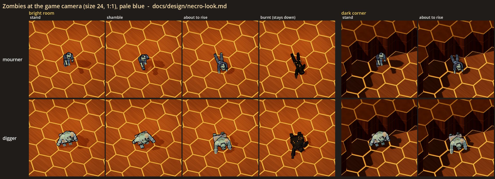
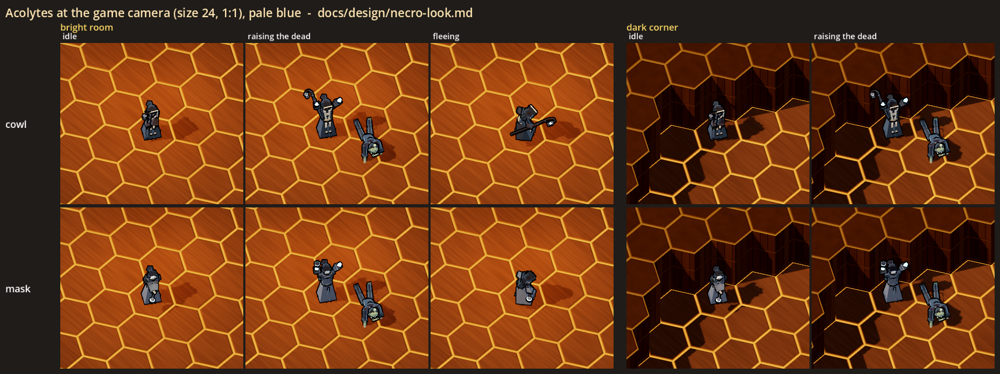
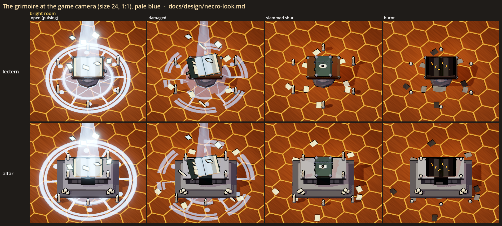
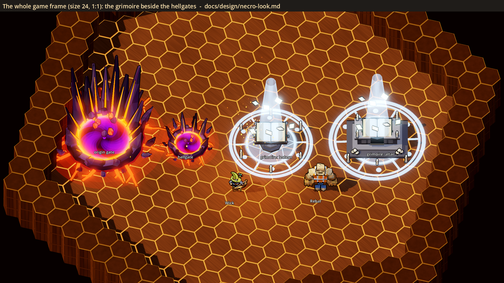
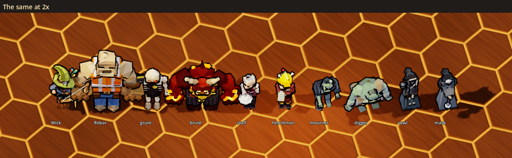
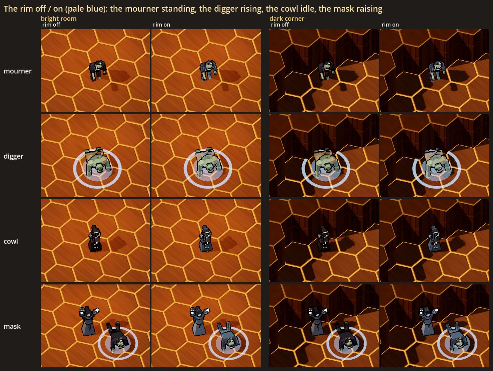

# The necro look: zombies, acolytes and the grimoire (a visual test)

Status: **[look-dev only]**, 2026-10-29; **the zombie is the game's since 2026-10-31** (haunted-build-plan.md, "H3 as
built": the `zombie` monster kind wears `ZombieModel`, mourner or digger, its body lies in `pose_rise(0)`, stands up through
`pose_rise(k)` and burns into the charred build). The acolytes, the procession and the grimoire are still look-dev only. The test exists in the gym (`--gym`) and in a look lab, and its job is to help the user decide how the
haunted contracts' necromancer family should look.

The decisions this serves (new-themes.md, "Ghost house: haunted contracts"):
- **Zombies**: "slow and tough, and they get back up unless burned" (Other enemies, a proposal).
- **Necromancer acolytes**: "mobile host monsters that flee and raise bodies" on floors 1-2 (The mission, a proposal).
- **The grimoire**: the origin source, "pulsing out the dead until it is slammed shut or burned", a host-arbitrated world
  object like a hellgate, "a physical object, never text to read" (The mission, a proposal).

The glow is the ghost look the user picked (ghost-look.md, 2026-10-29: "The rim look is really good"): the ghost colour
on eyes, hands, flames and pages, and the rim (the faceted fresnel) on the raised dead.

## The user's read (2026-10-29)

- **The zombie is the mourner** (asked whether "the zombie" meant the mourner: "Yes, but let's look at the shape of the
  torso first").
- **No coat tails**: "The coattails definitely don't read. Remove them."
- **A thin torso**: "And let's make it a thin torso." The coat now tapers from a narrow chest (0.42 wide, was 0.56) to a
  thin waist (0.26, was 0.46) and is shallower; the shoulders, arms and legs moved in to match, and a hunched upper back
  was added. The user: "Better!"
- **No ring under a rising zombie**: "Drop the ring." The motes rising off it stay as the "it will get up" tell.
- **The grimoire: a much smaller lectern, and the phases in the effects round the book.** The user: "The lectern should be
  much smaller." and "The damaged and burnt don't read correctly. Maybe let's do it with the effects surrounding the book
  instead. The book itself could go from open to closed." The lectern set piece is now 0.85 (was 1.4; the altar stays
  1.4). The states are **open**, **weakened**, **failing** and **shut**: the book stays whole and open until it is shut,
  and the column of light thins and stutters, the circle breaks up, the circling pages and the candles go out and the
  light drops as it weakens. The torn and burnt books are gone. (The sections below still describe the first version.)
- **A failing book's flicker tends red**: "Failing - maybe we have the flicker tend red?" Failing, its column, circle and
  light lean toward red (`GrimoireModel.FAIL_RED`), most in the stutter's dips.
- **The grimoire stands on the altar** (the user, 2026-10-29: "I like the bigger size"): the altar at 1.4 over the
  lectern at 0.85.
- **The eye on the shut cover, alive** (the user: "the eye on the cover of the book isn't coming across well. Can we
  adjust it?"). A flat almond with a glowing iris was "worse"; the user picked "A live eye: keep it fleshy, but make it
  bulge out of the cover, with veins and a lid half closed. It reads as creepy and alive." Then: "Raise the top lid more,
  and can the pupil move around?" So: a yellowed eyeball bulging from a rim of flesh, red veins crawling to the iris, a
  yellow iris with a slit pupil, a heavy upper lid over the back of it (`GrimoireModel._live_eye`). The iris is its own
  node and looks around: it holds a gaze, then darts to the next (`eye_dir`, `_look`). See it move in the gym
  (`--gym-act necro`, Experiments > Grimoire > shut).
- **The acolyte is the cowl** (the user, 2026-10-29: "Cowl"): the black robe, the bone-white stole, the staff and lantern.

## The procession [look test, 2026-10-29]

The user asked to revisit the acolyte (new-themes.md, "Zombies and acolytes": "acolytes should actually be traveling around
the map as a procession with monsters. So they would come across bodies and raise them"), then: "Lets build the
procession". Cosmetic like the rest of this test: `NecroProcession` (`scripts/art/lowpoly/necro/necro_procession.gd`).

- The acolyte (the cowl) leads, two zombies walk behind it in single file round a loop (an oval 10 by 6.4).
- When it comes level with a downed body beside the path, it stops (the file stops), turns to it and raises it: arms up,
  the body pushes up on its arms, stands, and shambles to the back of the file, which grows.
- At each new lap the zombies past the first two fall where they walk: the gym's stand-in for the crew knocking them
  down, so the next lap has bodies to raise again.
- The user's first read (2026-10-29), on the stills (not the motion): "Too cramped: the walkers are 1.15 apart and
  overlap at the game camera, so the file reads as a clump. I'd space them wider." "Too small: a leader and two zombies
  doesn't read as a procession. It could start with four, maybe with a second acolyte or a carried lantern." "the acolyte
  needs something to make it stand out more. It is too bland." So: walkers 1.8 apart on a bigger loop (12 by 7.6), four
  zombies, a second acolyte bringing up the rear (it waits while a raised zombie joins, and catches up when the file
  shortens), and the cowl's lantern now lights the floor round it in the ghost colour (`LanternLight`, 5.0 over 5 units)
  with motes drifting off it: a pool of cold light walking with each acolyte. The sheet is now candle-dark (the haunted
  mansion's light), where the pools show; in a bright room they are lost.
- Not built: the fight (the acolyte hanging back to raise what falls, fleeing when hurt), being interrupted by a hit, a
  route through real rooms, other monsters in the file.

`procession.png` (`--set procession`): six moments of the first raise at the game camera. In the gym: Spawn > Necro (look
test) > "procession (acolyte and zombies)", or `--gym-act procession`.

## What the user is choosing

- **Which zombie**, or both: the **mourner** or the **digger**.
- **Which acolyte**: the **cowl** (decided, see "The user's read").
- **Which grimoire stand**: the **altar** (decided, see "The user's read").
- **Two switches**, which can be set separately:

| Switch | Options | What it does |
|---|---|---|
| **Necro rim** | off, **on** | The ghost rim on the zombies (and a fainter one on the acolytes). Their eyes, hands and lights glow either way. |
| **Ghost colour** | **pale blue**, ecto green | The ghost look's own switch. The necro family's glow follows it: eyes, hands, the lantern and the censer, the candle flames, the pages, the column of light, the circle on the floor and the grimoire's light. |

The defaults are in bold. The **Grimoire** row (open / damaged / shut / burnt) is not a choice: it switches every grimoire
in the gym between its four states, so they can be seen live.

## The sheets

All the game-camera sheets are at yaw 45, pitch -56, orthographic size 24 and 1:1 game pixels, in the ghost look lab's
mansion room (wood boards and panelling, `HexMapView`, `DungeonLook`, one warm downlight pool). The **bright room** is
under the pool. The **dark corner** is the room's far corner in the walls' shadow. The `_2x` sheets are the middle of each
cell doubled with nearest-neighbour scaling: easier to read on a page, but use the 1:1 sheets to judge the game.



`zombie.png`: a row per zombie. Standing, shambling, about to rise and burnt in the bright room, then standing and about to
rise in the dark corner. `zombie_2x.png` is the same doubled.



`acolyte.png`: a row per acolyte. Idle, raising the dead (a zombie pushing up in front of it) and fleeing in the bright
room, then idle and raising in the dark corner. `acolyte_2x.png` is the same doubled.



`grimoire.png`: a row per stand. Open (pulsing), damaged, slammed shut and burnt. `grimoire_2x.png` is the same doubled.



`grimoire_scale.png`: the whole game frame. The origin gate, a hellgate and both grimoires (open), with Wick and Rebar in
front for scale.



`lineup.png` and `lineup_2x.png`: Wick, Rebar, the grunt, the brute, the staff, the henchman, then both zombies and both
acolytes, at the game camera.



`strip_rim.png`: the rim off and on, in both lights. The mourner is standing, the digger rising, the cowl idle and the mask
raising.

`close_zombie.png`, `close_acolyte.png` and `close_grimoire.png` are closer and lower (pitch -30) to show the models. They
are not how the game plays.

The stills freeze the pulses, the loops and the grimoire at one moment. In the gym they move: the zombies sway and
shamble, a downed zombie pushes up and sinks back on a loop, the acolytes raise and flee, and the grimoire pulses, its
pages circle and its circle turns.

## How they read at the game camera (first impressions, for the user to overrule)

- **Zombie vs the grunt and the hell family.** Both zombies read as a different family. The grunt is bone-white, upright,
  ember-eyed and carries a sword. The brute and the imps are red, black and glowing orange. The zombies are grey-green,
  hunched, empty-handed and pale-eyed.
- **The mourner** reads most like "a zombie" from above: the dark coat, the green head lolled forward, one arm out in front.
  It is about the grunt's height, so "tough" comes from the behaviour, not the size.
- **The digger** reads as a big, heavy thing. Up close it is a bloated, stitched corpse in a shroud, but at the game
  camera it can pass for an ogre. If the user wants a "tough zombie" that still reads as a zombie, the mourner's shape at
  the digger's bulk may be the better route.
- **About to rise** is the clearest state on the sheet. The soft ring and pool under the body, and the motes in the gym,
  say "this is not dead yet" from across the room. **Burnt** reads as a black heap with embers, with no ring, which is the
  difference the player needs. The ring may be too loud: at the 1:1 sheet it is as bright as the grimoire's circle.
- **The acolytes** read as hooded cultists, clearly not staff (short, white collars, a yellow hard hat) and not heroes. At
  the game camera they are small dark shapes. "Human" comes from the pale face in the cowl's hood and the white mask, and
  only up close. **Raising the dead** is the strongest pose of the set: arms up, glowing hands and a zombie pushing up in a
  ring in front. Idle in the dark corner they nearly vanish except for the lantern or the censer. That suits a fleeing
  caster, but it may be too hard to find.
- **The cowl vs the mask.** At the game camera the difference is the staff with its lantern (a long diagonal line, very
  visible when fleeing) against the censer (a small lit dot). Up close the mask's white face is the stronger image.
- **The grimoire** is about as big as the origin gate on the floor, and it does read as the room's objective. The circle,
  the column of light and the circling pages carry it. It is still less loud than the origin gate, which is bigger, taller,
  saturated and moving. In pale blue on the warm floors the glow is close to white, and ecto green would separate it more
  from the room's own lights. **Damaged** reads through the broken circle, the thinner column, a torn page block and pages
  on the floor. **Shut** and **burnt** read as finished: no light at all. Shut is a green book with the eye on its cover;
  burnt is black with ember cracks.
- **No text.** The pages are blank light, the cover has an eye (a picture), and the circle is rings, spokes and dots.
- **The rim** on the dead makes them look cooler and a little "lit from within", most visibly in the dark corner. On the
  acolytes it turns the black robes slate-blue. It is subtle at 1:1 either way.

## What was built

All of it is cosmetic only: plain nodes with no HP, no AI, no collision and no networking. The randomness (the start of
each gym loop) comes from `GameWorld.fx_rng`. The models' own variety is seeded per model.

| Piece | Where | What |
|---|---|---|
| `NecroLook` | `scripts/art/lowpoly/necro/necro_look.gd` | The family's shared look. Its toon body is the ghost look's (`GhostLook.body_code`: the monsters' shader with the rim) plus the ordinary ink outline. It has the floor glow (a rise mark, or the necromancer's circle drawn from rings, spokes and dots), the motes, the smoke and embers, and the two switches (`pick`, `reset`). The glow colour is `GhostLook.color_now()`. |
| `ZombieModel` | `scripts/art/lowpoly/necro/zombie_model.gd` | A `MonsterModel` with two variants, `mourner` and `digger`, and a `charred` build. `apply_idle` stands or shambles (from the walk speed: a lurch onto a dragged left leg). `pose_rise(k)` lies it face down and pushes it up on its arms, with the rise mark and motes (smoke when charred). `stand_up` goes back. Parts are named like a monster's, and the windup and swing hooks are wired, so a real zombie could use it. |
| `AcolyteModel` | `scripts/art/lowpoly/necro/acolyte_model.gd` | A `MonsterModel` with two variants, `cowl` and `mask`. `apply_idle` stands or flees (from the speed: hunched, the robe flapping, looking back). `set_raise(k)` raises the dead: arms up and out, the hands lit, the head back. |
| `GrimoireModel` | `scripts/art/lowpoly/necro/grimoire_model.gd` | The set piece: a `lectern` or an `altar`, in one of four states (`open`, `damaged`, `shut`, `burnt`), scaled up 1.4. The circle, candles, the column of light, the circling pages, the motes and a pale light go with it when lit; smoke, embers and a small warm light when burnt. Its heartbeat is the origin gate's rate; a damaged one stutters. `freeze_at` holds a moment for the lab. |
| `NecroBody` | `scripts/art/lowpoly/necro/necro_body.gd` | One gym figure: a kind, a variant and a pose, looping live (shamble a line and back, lie / push up / sink, raise a zombie in front, flee a line and back) or holding a still for the lab (`pose_still`). In `GhostLook.GROUP`, so the Ghost colour and the necro switches redress it (a rebuild). |
| The gym | `GymSpawns` group `necro`, `GymDev.experiments()` | Sixteen spawn buttons under **Necro (look test)**: "zombie (mourner): stand / shamble / rising / burnt", the same for the digger, "acolyte (cowl): idle / raise / flee", the same for the mask, and "grimoire: lectern" and "grimoire: altar". Two rows in **Experiments**: **Necro rim** (off / on) and **Grimoire** (open / damaged / shut / burnt). `--gym-act necro` puts a shambling and a rising zombie, an acolyte raising one and the grimoire on its lectern in front of the player. |
| The lab | `scripts/art/lowpoly/necro/necro_look_lab.gd`, `scenes/necro_look_lab.tscn` | Renders the sheets above. |
| Test | `tests/test_necro_look.gd` | Checks the gym entries and rows; every builder headless (parts, a triangle budget, the glow in the ghost colour, the ink kept, lying and rising, raising and fleeing, every grimoire state's lights, no text nodes); the spawns being cosmetic and looping; the switches and the Ghost colour redressing them live; the real grunt untouched; and the lab's builders. |

(As the test was built. Since H3 `MonsterDefs` has a `zombie` row whose monster wears `ZombieModel`; see the status line.)
The real monsters, `MonsterMaterial`, `GhostLook`, `MonsterDefs` and the contracts are unchanged. Nothing outside the gym
and the lab creates a `NecroBody`.

## Running it

```powershell
.\run.ps1 --gym --no-mic                      # the panel: Necro (look test) to spawn, Experiments > Necro rim / Grimoire / Ghost colour
.\run.ps1 --gym --no-mic --gym-act necro      # a row of them in front of you as the gym opens
```

The sheets need a real window (not `--headless`):

```powershell
$env:CAST_GODOT = "<abs path>\Hero-Reader\third_party\godot\Godot_v4.7-stable_win64_console.exe"
& $env:CAST_GODOT --path . --resolution 1920x1080 -- --scene res://scenes/necro_look_lab.tscn --shot "<abs path>\docs\design\necro_look\zombie.png" [--set zombie|acolyte|grimoire|scale|lineup|rim|close]
```

This writes every sheet next to `--shot` (about 16 s). `--set` renders one group only.

## Choices made for the test (the user may want a say)

- **The family is monochrome plus the ghost colour.** Grey-green flesh, soot and ash robes, bone, iron and stone, so the
  only colour on them is the glow, against the hell family's red, violet and ember.
- **The zombies keep their ink outline.** They are bodies, not ghosts; only the rim says the dead were raised.
- **The rise tell is a ring and a pool on the floor under the body**, plus motes rising. A burnt zombie gets smoke and no
  ring. The player needs to see which bodies will get up.
- **The zombies are empty-handed**: a grab or slam, not a weapon, unlike the grunt.
- **The acolytes are tall, narrow and robed to the floor**, the opposite of the staff's short pear shape. Their faces are
  human (the cowl's pale face, the mask's bare chin), but the hood or the mask hides most of it.
- **An acolyte raises a zombie in front of it** in the gym and on the sheets, so the pose tells its story.
- **The grimoire is outsized** (1.4, a book about 2.4 across) to hold its own beside an origin gate. Its pages are blank
  light, and its cover shows an eye, never a letter.
- **"Damaged" stands for the grimoire's later phase**: knocked askew, a page block torn away, the circle broken, the column
  thin and stuttering, two candles knocked over. A real build would pick its phases with the hellgate's.
- **Shut and burnt both go fully dark**, so neither can be mistaken for "still going".
- **The candle flames are the ghost colour**, not warm.
