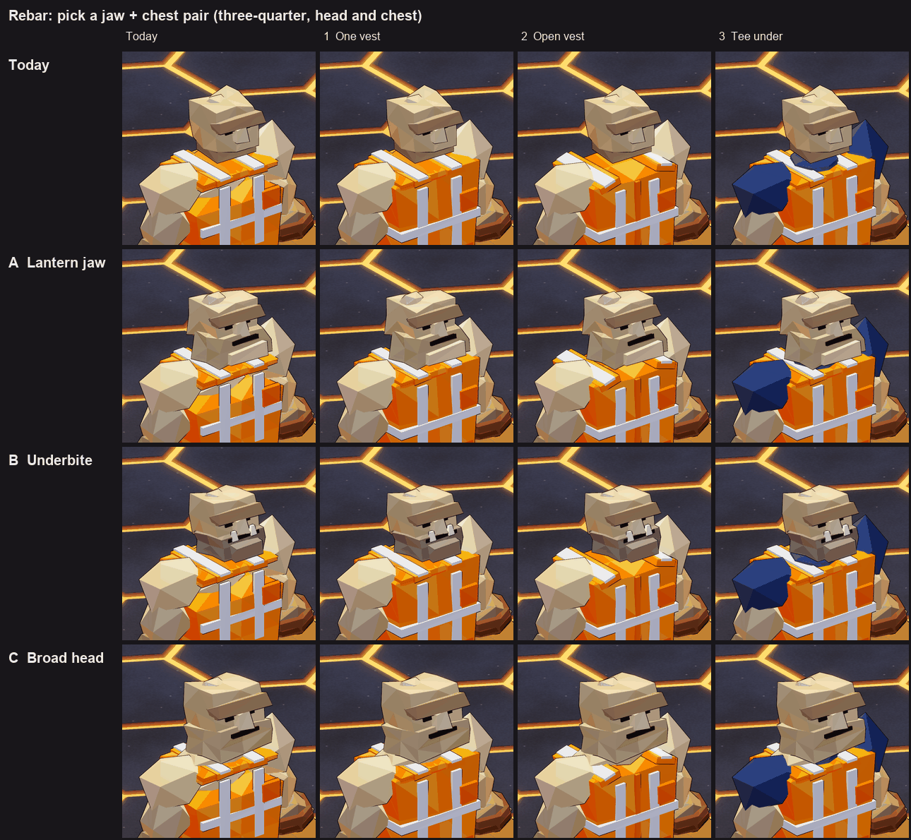
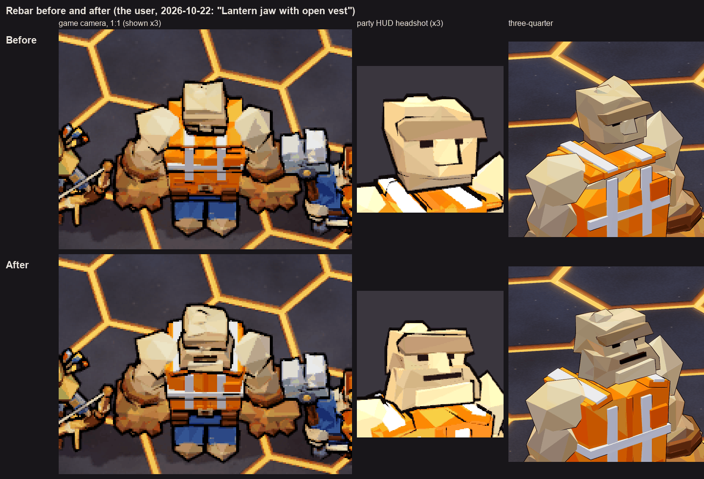
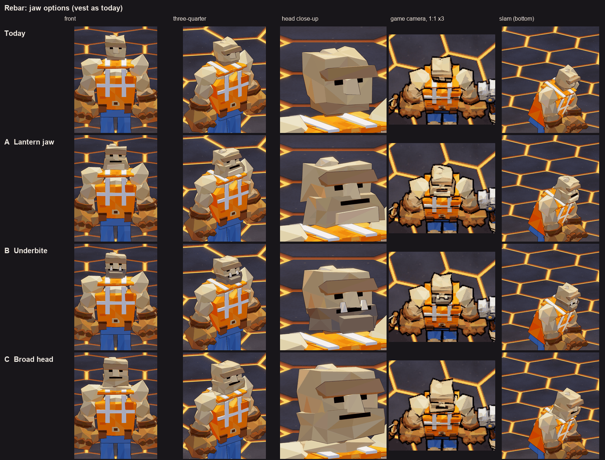
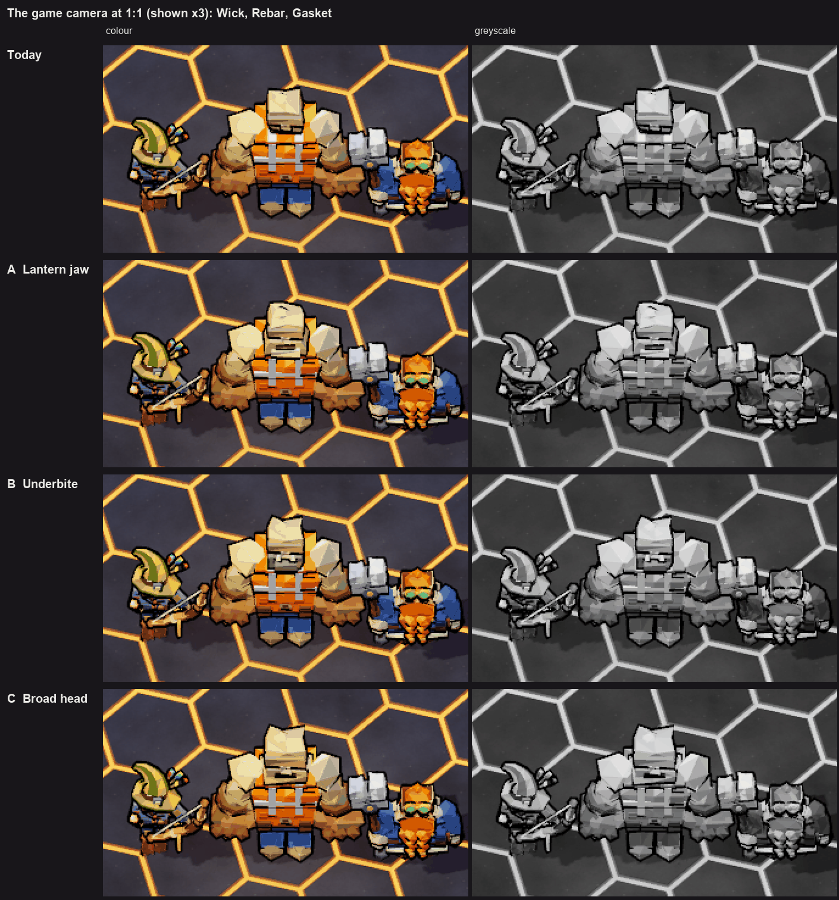
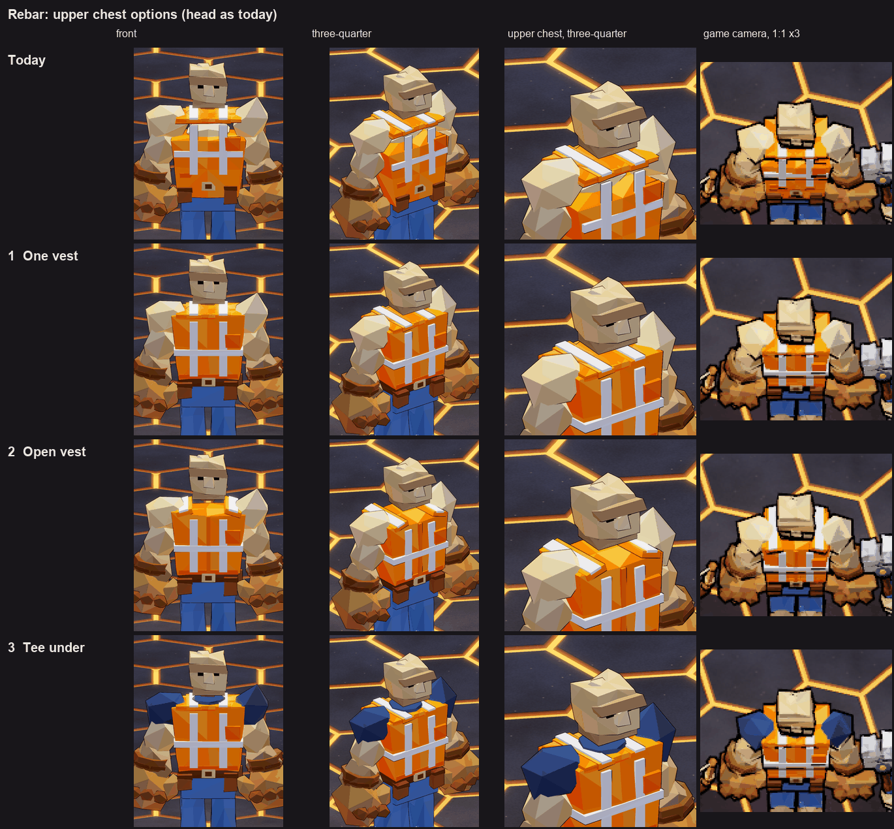
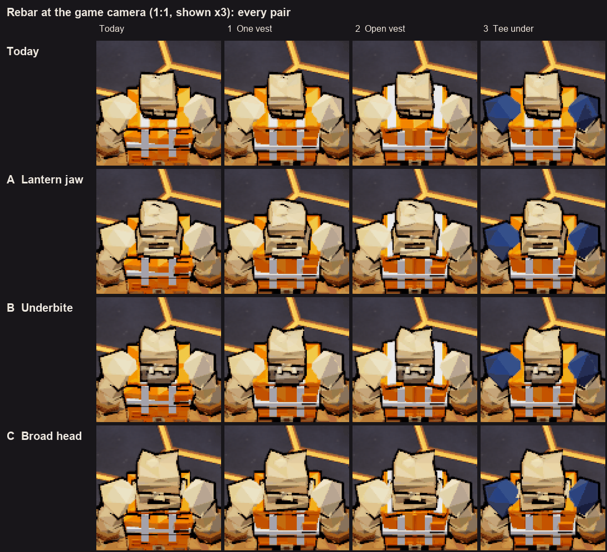

# Rebar's jaw and upper chest

Status: **decided and built** (2026-10-22). Sections 1-4 were the proposal; section 0 records the pick and what was built.

The user (2026-10-22): "And Rebar needs more of a jaw." Then: "We also need to look at Rebar's upper chest. It doesn't
read well with the orange neck collar but then flesh tone before more vest."



`sheet.png`: every jaw (rows) with every chest (columns), three-quarter, head and chest.

## 0. Decided (user, 2026-10-22): "Lantern jaw with open vest."

| Question | Decision |
|---|---|
| Jaw | **A Lantern**, with the 8-degree tip-back |
| Chest | **2 Open vest** (which also ends the bare stone band: the shell now runs from the belt to the neck) |



`before_after.png`: the game camera at 1:1 (shown x3), the party HUD's headshot (x3) and three-quarter, before and after.

As built (`RebarModel._head_soup`, `_vest_soup`): the lab's look-dev options (`--jaw` / `--chest`, `RebarModel.JAWS` /
`CHESTS`) are gone and the game's Rebar renders pixel-for-pixel as the lab's `--jaw lantern --chest open` did. He is 1248
triangles (was 1268). Checked:

- `test_rebar_model`, `test_zfight`, `test_move_feel_anim` (PoseClip over his walk, swings, slam and the strike-first
  bowl), `test_menu_backdrops`, `test_main_menu`, `test_hero_kits` pass. The held component rides the left glove and is
  unaffected.
- The headshot (`Headshots`) frames on the head mesh's bounds, so it follows the bigger jaw by itself: the face, jaw and
  chin fill the portrait and the open vest shows below.
- **The jaw and the arms.** The jaw is wider and juts further than the old head, so the arms now come close to it.
  Measured from the head's vertices against his shoulder and upper-arm boulders: at rest and through the slam the jaw's
  back corner touches the shoulder boulder by about 1 cm (hidden: stone under stone). At the peak of the bowl's
  follow-through (`bowl_a` = `BOWL_FOLLOW`, the right arm swung up and in by `BOWL_IN` 0.45) the upper arm passes about
  3.5 cm into the jaw's front corner for a few frames, with the arm in front of the chin. `BOWL_IN` 0.30 clears it; left
  as is for the animation's owner to decide.
- **The garage's "after" face scuffs** (`FACE_SCUFFS` in `scripts/ui/backdrops/after_job.gd`, fitted to the face by
  `face_fit`): with the head tipped back, Rebar's old plaster spot landed on the end of his mouth. It moved onto the jaw
  beside it (at 0.22, -0.10, a strip 0.14 long); the soot smudge sits on the chin plate. `test_menu_backdrops` passes.

## 1. Why he read this way (before)

- **No jaw.** The head is a 0.50-wide block with a thin jaw slab tucked under it, the same stone colour as the face. From
  the steep game camera (pitch -56) you see the top of the block and a sliver of brow; there is nothing below it to read.
- **The bare band is a bug.** `LowPoly.frustum` is centred on its origin, but `_vest_soup` places the vest's shell as if it
  started at its hem (`y0`). So the shell sits 0.43 lower than its own collar, top plate and shoulder straps, and the
  stone chest shows between them. The vest also covers most of the belt, so the buckle pokes through it.

## 2. Jaws



All three keep his brow, eyes and nose, and tip the head back 8 degrees so the game camera sees more face.

| | What it is | At the game camera |
|---|---|---|
| **A Lantern** | A block that widens downward past the skull and juts forward, a shade darker than the face, with a squared lit chin and the mouth across its front. The classic brute. | A clear jaw and mouth line under the brow. |
| **B Underbite** | The lower jaw pushed out past the upper face, a jutting chin and two lower teeth standing up in front of the lip, in a grey stubble shade. | Reads best: the dark jaw and the two white teeth carry at 1:1 and in greyscale. |
| **C Broad head** | The whole head 1.16x, a broad flush jaw, raised 0.06 on a thick bull neck that flares into the shoulders. | The head stops being dwarfed by the shoulder boulders; the jaw reads less than A or B. |



`lineup.png`: Wick, Rebar and Gasket at the game camera at the game's 1080p pixel scale (shown x3), colour and greyscale.

## 3. Chests



| | What it is |
|---|---|
| **1 One vest** | The vest shell runs from the belt up to the collar in one piece (what the code meant). Collar, top plate and straps as today. The belt and its pouches now show below the vest. |
| **2 Open vest** | The same full-height shell without the collar ring or top plate. The straps run out over the shoulders and down onto them, and a dark placket splits the front, so it reads as a vest worn open at the neck. |
| **3 Tee under** | One vest plus a navy tee: a crew neck instead of the collar, and the shoulder boulders become the tee's short sleeves. The stone shows only on his arms. |



`game.png`: every pair at the game camera (1:1, shown x3). Option 2's white straps over the shoulders read the most
"hi-vis" from above; option 3's navy shoulders change his silhouette's colour the most.

## 4. Checks (every pair, during the look-dev)

- Triangles: 1200-1340 (today 1268; budget 2500, `test_rebar_model`).
- `ZFightCheck`: nothing over 5 cm2 (the look-dev tape band stands off the vest a little more than today's).
- `PoseClip`: no arm inside the body over a sweep of the slam (top to bottom, with the forward bend), both punches, the
  bowl, the cast and the walk. `test_move_feel_anim`, `test_rebar_model` and `test_zfight` also pass with the pairs
  broad + tee, lantern + vest and underbite + open made the default (a temporary local change, not committed).

## Looking at him

```
godot --path . --resolution 1600x1600 -- --scene res://scenes/rebar_lab.tscn --views crew,head,headshot,bowl --shot <abs.png>
```

Views beyond the lab's own: `head` (face close-up), `crew` (the game camera with Wick and Gasket; also writes
`<base>_crew_crop.png`), `slam_up` / `slam`, `bowl` (the bowl's follow-through), `headshot` (the party HUD's portrait).
The look-dev sheets were rendered with the options the lab had then (`--jaw` / `--chest`, commit "Rebar look-dev: jaw and
upper chest options in the lab").
