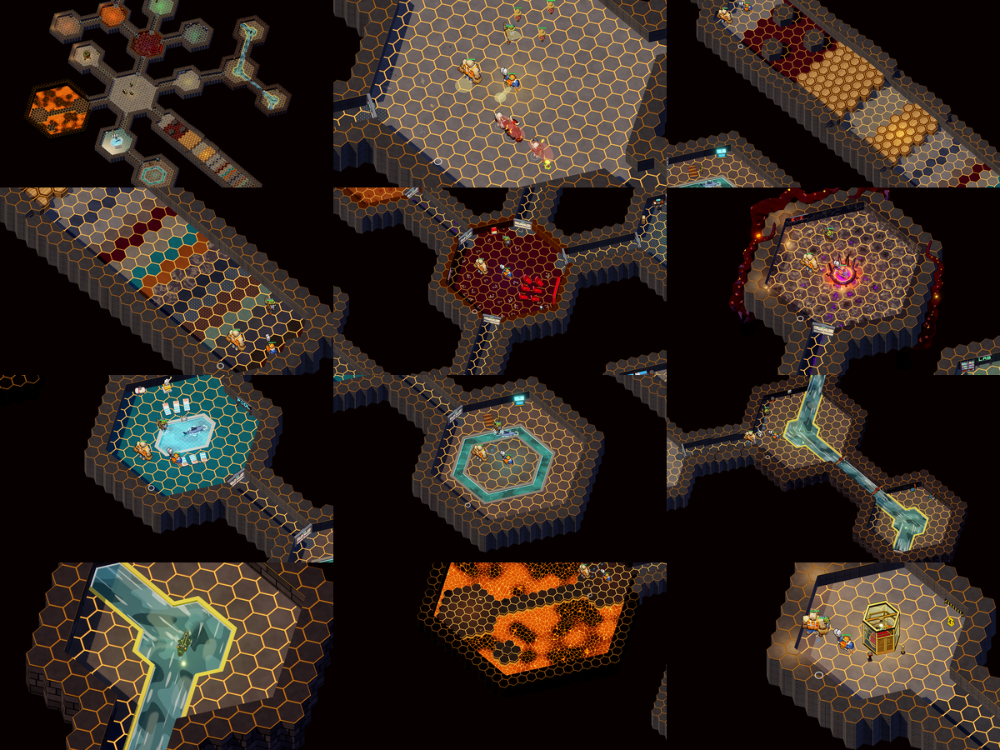
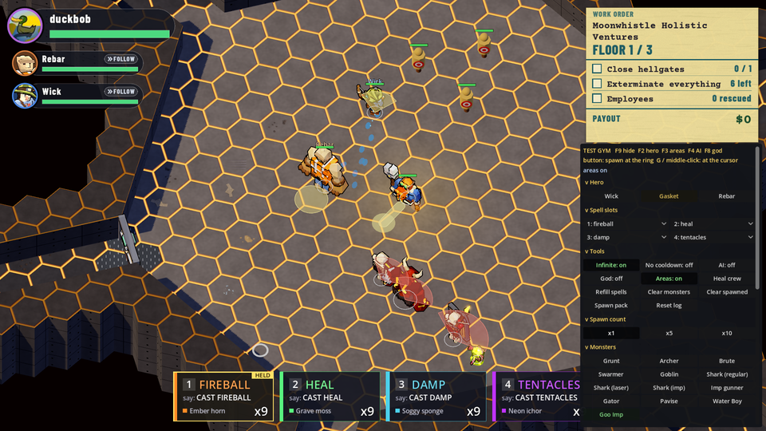

# Test gym (`--gym`)

A solo dev mode for trying any character, spell, monster or environment, and for combat tests, on one fixed map. User,
2026-10-22: "a little test gym mode. You can directly switch which character you are. There is a button to spawn a thing of
each type (updated dynamically). And the level covers all of the environments", "then we can use that for combat testing",
and "you should be able to spawn spell components or have an infinite supply".

## Launch

```powershell
.\run.ps1 --gym --no-mic                              # the gym, voice off (type a cast with Enter: "cast fireball")
.\run.ps1 --gym                                       # with the mic
.\run.ps1 --gym --move-feel grounded_anim --no-mic    # under a movement profile (F6 / F7 switch it live, as anywhere)
.\run.ps1 --gym --spells heal,corn --no-mic           # other starting slots (default fireball, heal, damp, tentacles)
.\run.ps1 --gym --no-fog --no-mic                     # the whole map shown
```

The gym is floor 1 of a contract rolled from its own seed (`GymMap.SEED`, unless `--seed` says otherwise), so the HUD, the
work order, the elevator (E: down rebuilds the gym as floor 2, out ends the job), the voice and every key work as on a real
floor. **Solo only:** in a crew (a shared run) the flag is ignored and the log says so. F5 / "Abandon contract" leave it for
the job board as usual.

## Keys (only in the gym)

| Key | Does |
|---|---|
| **F2** / Shift+F2 | next / previous hero (`HeroKit.ids()`); the hero buttons on the panel pick one |
| **F3** | hit areas on the floor: every hero's melee area (the profile's wedge or lane) and every monster's strike wedge |
| **F4** | monster AI on / off (off: they stand like dummies; hits and shoves still land) |
| **F8** | god mode for the crew (no damage taken) |
| **F9** | hide / show the panel |
| **F10** | Gasket's spin speed under `grounded_anim` (the timed sweep): a full turn in 20 / **25** / 30 frames, live (the panel's "Spin speed" too; `animation-research.md` "Gasket's spin, a timed sweep") |
| **F11** | the cast tell's mode (the "cast armed" rune + hand glow on your hero, `cast-armed-fx.md`): **colour** (the rune takes the spell's colour when the spell word is recognised) / **neutral** (it stays white until the release) / **off** (today). The corner tag and the panel's status line say which. `--cast-tell colour|neutral|off` sets it at launch, in the gym or in normal play |
| **G**, middle-click | spawn the last picked kind at the cursor |

F1 (voice panel), F5, F6 / F7 (movement feel), Esc and 1-4 (ready a slot) are the game's as ever.

## The panel

A plain dev panel on the right (not a trade form; never shown outside `--gym`), built at runtime from the registries
(`GymSpawns.entries()`), so new content gets its button with no change:

- **Hero**: one button per `HeroKit` hero. The switch re-kits the player's own hero node (`Hero.become`, as a seat handover
  does: the spell slots stay, the HP fraction stays); the AI ally who was that hero takes the player's old one, so the
  allies always play the other characters.
- **Spell slots**: a picker per slot (any available spell). **Infinite** (on by default): the slots never run out of
  charges. **No cooldown**: spells are ready at once (the attacks keep theirs). **Refill spells**: once, when Infinite is off.
- **Tools**: AI, God, Areas (F4 / F8 / F3), Heal crew (the downed get up), Clear monsters (all but the map's own sharks and
  gator), Clear spawned (everything the panel put down), Spawn pack (a mixed floor-3 pack), Reset log.
- **Spawn count**: x1 / x5 / x10.
- **Monsters**: every `MonsterDefs` kind. Factory kinds (grunt, archer, brute, swarmer, goblin, pavise, water boy, goo imp,
  and any new kind with a model) stand on free cells; **sharks** (regular, laser, imp) go into the pool under the ring (else
  the indoor pool), **the imp gunner** rides an imp shark, **the gator** goes into the sewer's water (its home region: under
  the ring when that is in it, else the first sump). A kind none of those can build gets a disabled button saying why.
- **Dummies**: a static training dummy and a walker, 5000 HP each (three static ones stand on the arena's north side).
- **Props** (every non-explosive `PricedProp.TABLE` kind; an electrical panel by water brings its live wire), **Hazards**
  (every explosive), **Staff** (every `EmployeeModel` style), **Components** (every spell's pickup, `SpellBook`; one that is
  not available yet is disabled), **Gates** (a hellgate, an origin gate), **Decor** (every `RoomThemeDefs.DECOR` kind).
- **Go to**: teleports to each environment.
- **Hit log** (`GymStats`): hits and damage the player dealt, the crew dealt and the player took, totals and per minute over
  the last 60 s, and the newest hits (amount, attacker, victim, weapon).

A spawn button puts its kind at the **ring**, which follows the mouse over the world and stays put while the mouse is on the
panel; G or a middle-click puts the last picked kind at the cursor. Every spawn lands on full, dry, free floor cells
nearest the point (out to 7 cells).

## The map (GymMap, `scripts/world/gym/gym_map.gd`)

One fixed floor built from the generator's own pieces (hex rooms and halls cut like DungeonGen's, `SewerLayouts.Builder`),
planned with the real planners (themes, props, explosives, decor, mail, doors, the sewer, the gator), round a big arena:

| Where | What |
|---|---|
| middle | **arena** (room:1): a flat radius-9 room with nothing planned in it, the three dummies |
| west | **lobby** (room:0): the start and the free-standing freight elevator (the exit) |
| east | **course** (room:2): pad, a slalom of pillars (carpet), a +1 step run (wood), the top (marble), a 3-level drop (tile), a +2 ledge to mantle (flagstone) and its drop, then the **material walk**: a band of every floor material (`FloorMaterials.FLOORS`) for every footstep |
| north-west | **offices** on narrow halls with office doors (the square doors): home cinema, wine cellar, server room (the staff), lab (a henchman), throne room with the **hellgate**, torture chamber |
| south-east | **indoor pool** and **shark moat** (PoolGeo carves them), a regular shark in each |
| north-east | a barracks, the **service stair** down (its service-style door) and a **sewer cluster** of three rooms: channels, sumps, wading water, the outfall and bars, a flooded narrow hall with its **sluices**, a ledged wide hall, the **electrical panel** with its **live wire**, the pumps, the **gator** in its territory |
| south-west | a **lava cave**: two rock chambers over a lava field, a two-wide **bridge**, an **isle** two lava cells off the rock that a damp's crust reaches, the **rim** |

Every room is a fog space; the lobby and the halls between the zones are wide (open), the office halls narrow (doors).





The pictures: `.\run.ps1 --gym --no-mic --no-fog --move-feel grounded_anim --gym-tour <abs dir>` (GymTour: each view, the
sheet and the panel, then it quits).

## Code

`GymMap` (the map and the plan), `GymDev` (`scripts/app/dev/gym_dev.gd`: the driver: keys, the switch, the tools),
`scripts/app/dev/gym/`: `GymSpawns` (the spawn list and the spawners), `GymPanel`, `GymStats`, `GymOverlay` (the hit areas,
drawn with `HitAreaShape`, which the strike lab's overlay shares), `GymTour`. GameDev's hooks: `_parse_args` (`GymDev.parse`),
`_dev_floor` (the map and plan), `_dev_on_floor_ready` (the driver). `tests/test_gym.gd` builds the map and checks every
environment is there and reachable, that the spawn list covers every registry entry, spawns one of each and steps the world,
and switches through every hero. The golden floors do not move: nothing in the generator calls the gym.
